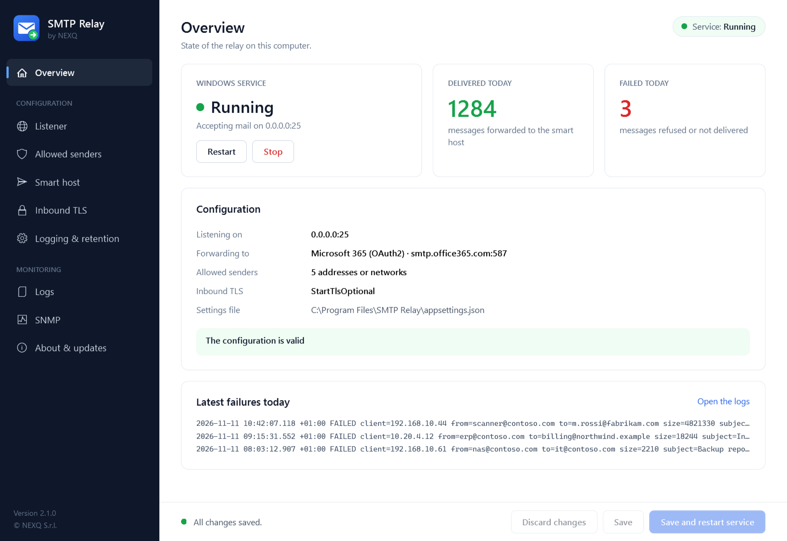
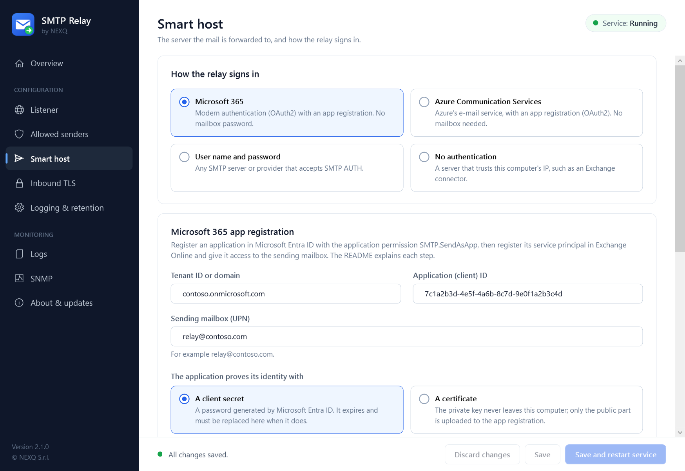
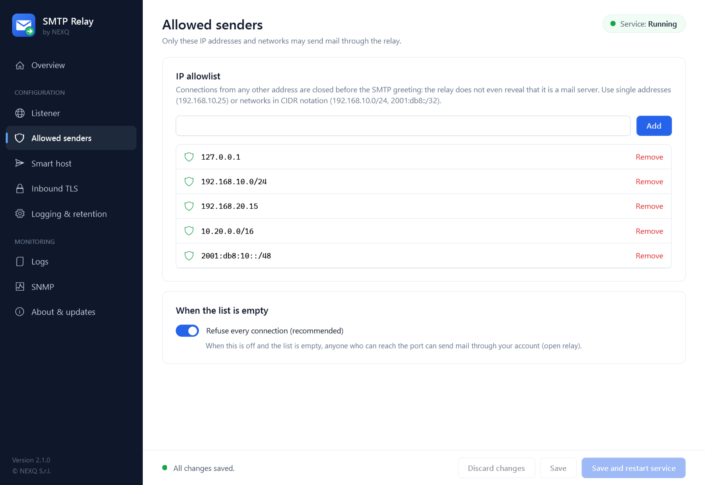
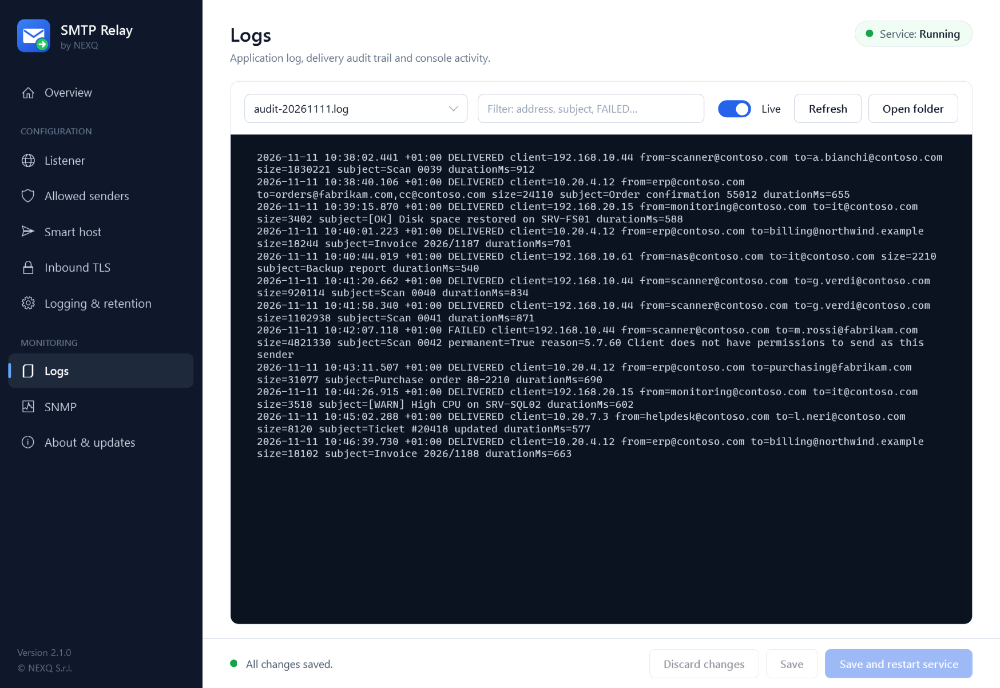
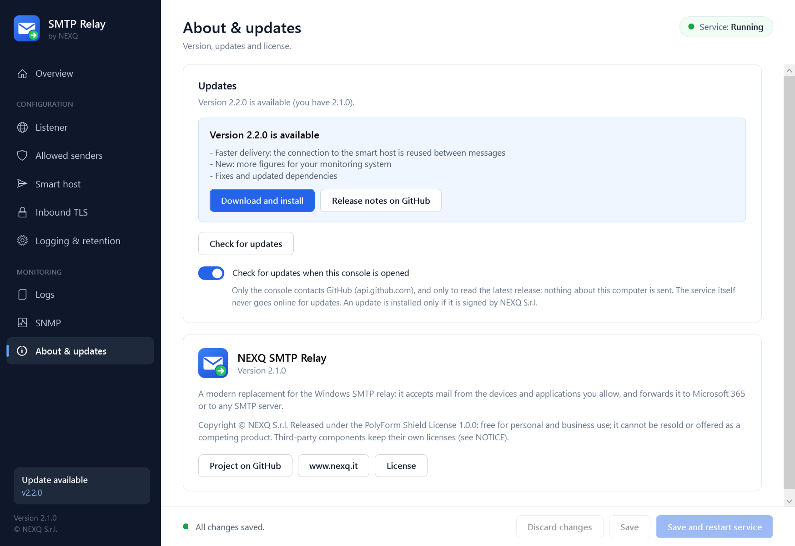
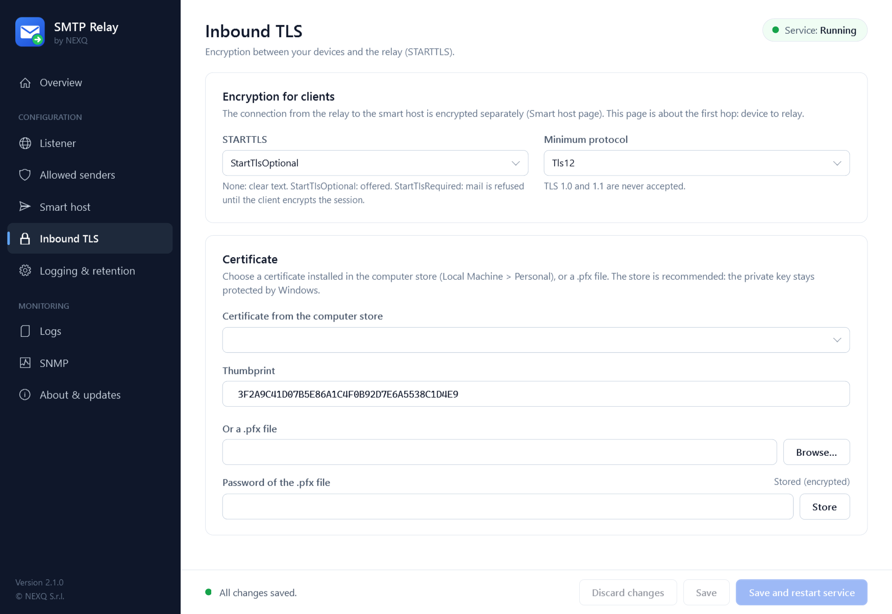
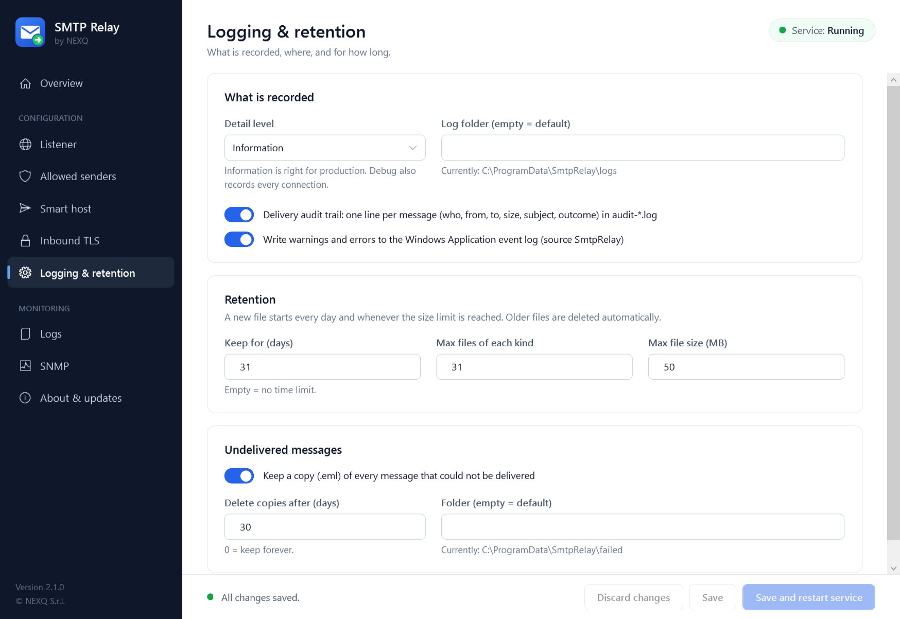
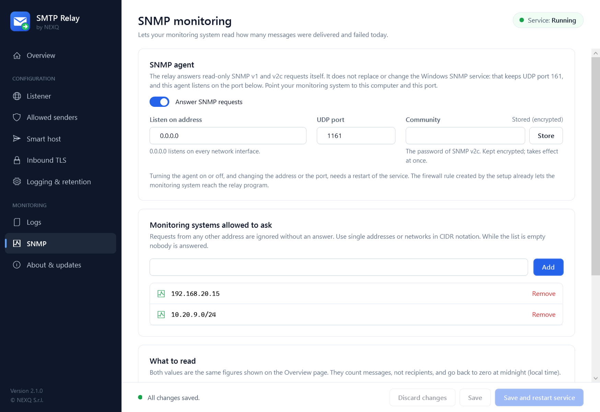
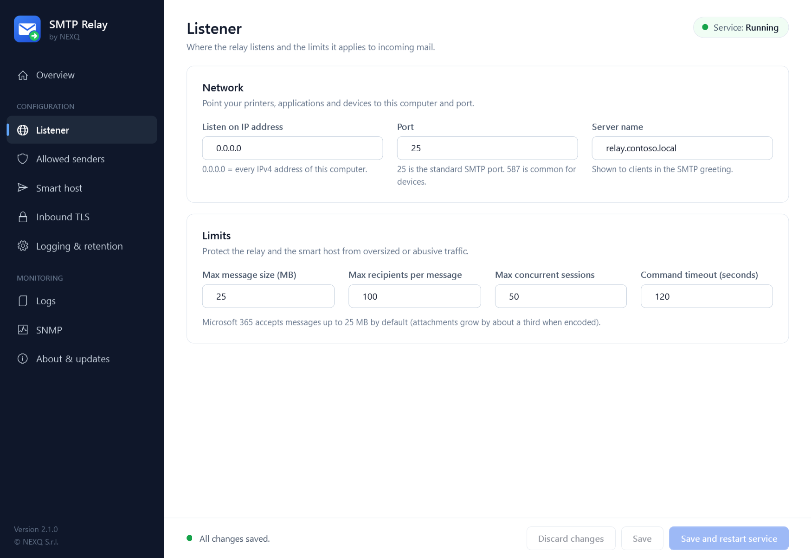
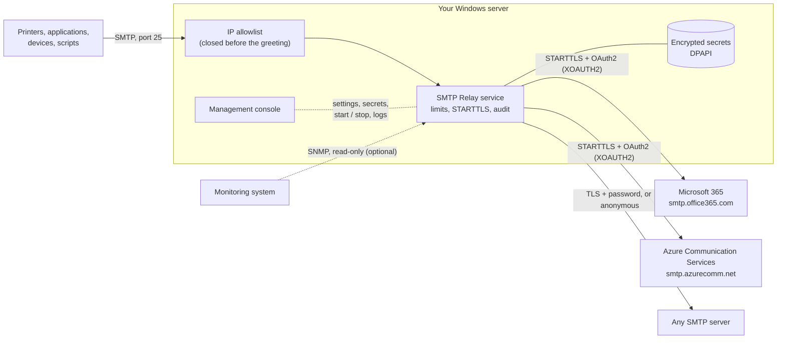

<p align="center">
  <picture>
    <source media="(prefers-color-scheme: dark)" srcset="assets/brand/Logo_SmtpRelay_White.png">
    
  </picture>
</p>

<h3 align="center">The SMTP relay Windows Server should have had.</h3>

<p align="center">
  A modern replacement for the IIS 6 SMTP relay: printers, applications and devices keep sending plain SMTP,<br>
  the relay forwards everything to Microsoft 365 with OAuth2, or to any SMTP server. One setup, one console, no scripts.
</p>

<p align="center">
  <a href="https://github.com/NEXQsrl/SMTP-Relay/releases/latest"><b>Download the latest release</b></a> ·
  <a href="#install-in-five-minutes">Install</a> ·
  <a href="#features">Features</a> ·
  <a href="#microsoft-365-setup">Microsoft 365</a> ·
  <a href="README_IT.md">Italiano</a>
</p>

<p align="center">
  
  
  
  
  
  <a href="LICENSE"></a>
</p>

<p align="center">
  
</p>

## Why SMTP Relay

Multifunction printers, ERP systems, NAS boxes, monitoring tools and old line-of-business applications still send
mail with plain SMTP, often without TLS and without modern authentication. Microsoft 365 no longer accepts that, and
the usual answer, the IIS 6 SMTP service, is deprecated, has no OAuth2, and is managed from a console of 2003.

SMTP Relay sits between those devices and your mail system:

- **Devices stay as they are.** They send to the relay on port 25 (or the one you choose), with no password. The relay
  decides who may send by IP address.
- **Microsoft 365 with modern authentication.** The relay signs in with an app registration (OAuth2 client
  credentials, XOAUTH2). No mailbox password is stored anywhere, and Basic authentication can stay disabled in the tenant.
- **Or any other server.** User name and password over TLS, or no authentication for an Exchange connector that
  trusts your public IP.
- **Not an open relay by design.** An empty allowlist refuses everyone. A connection from an address that is not
  allowed is closed before the SMTP greeting: the relay does not even reveal that it is a mail server.
- **Secrets are encrypted.** Passwords and client secrets are protected with Windows DPAPI and are bound to the
  computer. They are never written to the settings file and never shown again.
- **You know what happened to every message.** One audit line per message (who, from, to, size, subject, outcome), a
  rotating application log, the Windows event log, and a copy of every message that could not be delivered.
- **A real setup and a real console.** A signed installer registers the service and the firewall rule. A graphical
  console configures everything, tests the connection, shows the logs and installs updates from GitHub.

## See it

<table>
  <tr>
    <td width="50%"><br><b>Smart host</b>: Microsoft 365 or Azure Communication Services with OAuth2 (client secret or certificate), user name and password, or no authentication. The secret is stored encrypted with one click; <i>Test connection</i> and <i>Send a test message</i> use the settings on screen.</td>
    <td width="50%"><br><b>Allowed senders</b>: single addresses and CIDR networks, IPv4 and IPv6. Everything else is disconnected before the greeting.</td>
  </tr>
  <tr>
    <td width="50%"><br><b>Logs</b>: the delivery audit trail and the application log, live, with a filter by address, subject or outcome.</td>
    <td width="50%"><br><b>Updates</b>: the console finds a newer release on GitHub and installs it after checking its SHA-256 and the NEXQ signature. Settings are kept.</td>
  </tr>
  <tr>
    <td width="50%"><br><b>Inbound TLS</b>: STARTTLS offered or required for clients, with a certificate from the Windows store or a .pfx file. TLS 1.2 minimum.</td>
    <td width="50%"><br><b>Logging & retention</b>: detail level, rotation by day and by size, how long to keep logs and undelivered messages.</td>
  </tr>
  <tr>
    <td width="50%"><br><b>SNMP</b>: your monitoring system reads the messages delivered and failed today. Read-only, with a community kept encrypted and a list of allowed monitoring systems.</td>
    <td width="50%"><br><b>Listener</b>: address, port and the limits applied to incoming mail.</td>
  </tr>
</table>

<sub>The screenshots show the real interface of version 2.1.0 with sample data (addresses, tenants and messages are examples).</sub>

## Features

### Receiving
- **SMTP listener** on the address and port you choose (25 by default), with limits on message size, recipients per
  message, concurrent sessions and idle time.
- **IP allowlist** with single addresses and CIDR networks (IPv4 and IPv6), applied at connection level. Fail-closed:
  an empty list refuses every connection unless you explicitly turn that off.
- **STARTTLS for clients**, optional or required, TLS 1.2 or 1.3 only, with a certificate from `LocalMachine\My`
  (recommended) or a `.pfx` file whose password is kept in the encrypted store.

### Forwarding
- **Microsoft 365** with OAuth2 client credentials (XOAUTH2). Tokens are cached and renewed automatically; a rotated
  client secret is picked up without restarting the service.
- **Any SMTP server** with user name and password, or **without authentication**.
- **Azure Communication Services** (Email) over SMTP with OAuth2: the relay signs in as a Microsoft Entra
  application, with no mailbox and no password in the settings.
- **Client secret or certificate** for the Microsoft Entra application, in both Microsoft modes. With a certificate
  the private key stays in the Windows certificate store of the server; the console creates one for you.
- **Encryption towards the smart host is enforced**: STARTTLS or implicit TLS. Credentials are never sent over a
  connection that is not encrypted, even if the server stops offering STARTTLS, unless you explicitly allow it.
- **Retries** with a growing delay on temporary errors. The client receives `250` when the smart host accepted the
  message, `451` when it should try again, `554` when the message was refused for good.
- **Fixed sender** (optional): replaces the envelope sender of every message, for servers that accept one address only.

### Security
- **Encrypted secrets**: DPAPI (machine scope) plus a random per-installation key. The files are bound to the
  computer and cannot be copied to another one.
- **Protected data folder**: logs, undelivered messages and secrets are readable by SYSTEM and Administrators only.
- **Signed binaries**: the setup, the uninstaller and every program file are signed by NEXQ S.r.l.
- **Updates are verified**: SHA-256 from GitHub and the NEXQ signature, before anything is run.
- **No telemetry.** The service contacts only your smart host (and Microsoft's sign-in service in Microsoft 365
  mode). The console contacts GitHub only to look for a newer release, and you can turn that off.

### Operations
- **Graphical console** in English for every setting, with validation as you type and clear warnings (open relay,
  credentials in clear text, missing secret).
- **Delivery audit trail**: one line per message, in its own file, safe against log forging (line breaks in
  subjects and addresses are removed).
- **Logs** with daily and size rotation and automatic retention, plus warnings and errors in the Windows
  Application event log (source `SmtpRelay`) for your monitoring system.
- **Undelivered messages** saved as `.eml`, removed automatically after the number of days you choose.
- **Command line** for automation: install, start, stop, credentials, connection test, configuration check.
- **Automatic restart** of the service after a crash.
- **SNMP** (v1 and v2c, read-only): messages delivered and failed today, for your monitoring system, with a MIB
  file. It runs next to the Windows SNMP service, on its own port.

## Install in five minutes

You need a Windows Server (or Windows 10/11) that your devices can reach, and administrator rights on it.
Nothing else: the .NET runtime is included in the setup.

**1. Download** `SmtpRelay-Setup-2.1.0.exe` from the
[latest release](https://github.com/NEXQsrl/SMTP-Relay/releases/latest). The release lists the SHA-256 of every file
(`SHA256SUMS.txt`): check it with `Get-FileHash .\SmtpRelay-Setup-2.1.0.exe -Algorithm SHA256`.

**2. Trust the signature (once per server).** The files are signed by *NEXQ S.r.l.* with a self-signed certificate.
Windows trusts it only after you import it. The public certificate is inside the signature of the file; extract it,
check that its thumbprint is `989A5C82203AB19B6DB29FC447E8CB5EBEEB60D8`, then import it (elevated PowerShell):

```powershell
$cert = (Get-AuthenticodeSignature .\SmtpRelay-Setup-2.1.0.exe).SignerCertificate
$cert.Thumbprint          # must be 989A5C82203AB19B6DB29FC447E8CB5EBEEB60D8
Export-Certificate -Cert $cert -FilePath .\NEXQ-CodeSigning.cer | Out-Null
Import-Certificate -FilePath .\NEXQ-CodeSigning.cer -CertStoreLocation Cert:\LocalMachine\Root
Import-Certificate -FilePath .\NEXQ-CodeSigning.cer -CertStoreLocation Cert:\LocalMachine\TrustedPublisher
```

After this, Windows shows *Verified publisher: NEXQ S.r.l.* when you run the setup. See
[Antivirus, SmartScreen and the signature](#antivirus-smartscreen-and-the-signature) if something still blocks it.

**3. Run the setup.** It installs the program in `C:\Program Files\SMTP Relay`, registers the Windows service
*NEXQ SMTP Relay* (it does not start it yet), adds the firewall rule and opens the console.

**4. Configure.** In the console:

| Page | What to set |
|---|---|
| **Allowed senders** | The IP addresses or networks of your devices, for example `192.168.10.0/24`. |
| **Smart host** | *Microsoft 365* (see [below](#microsoft-365-setup)), *Azure Communication Services* (see [below](#azure-communication-services-setup)), or host, port and credentials of your server. Type the secret and press **Store**. |
| **Listener** | The port, if 25 is not what you want. |

Press **Test connection**, then **Send a test message**.

**5. Start.** Press **Save and restart service** (or **Start** on the Overview page). The Overview page must show
*Running*.

**6. Point your devices** to the name or IP address of this server, port 25, no authentication, no TLS (or STARTTLS
if you configured a certificate). Each message appears in the **Logs** page within seconds.

> **Configure before you start the service.** With the settings of a fresh installation the service has nothing to
> forward to, so it stops as soon as it is started and writes the reason to the log. See
> [The service does not start](#the-service-does-not-start).

> **Replacing the IIS SMTP service?** Two programs cannot listen on the same port. Stop and disable *Simple Mail
> Transfer Protocol (SMTP)* in the Services console (or remove the SMTP Server feature) before starting the relay,
> or run the relay on another port while you migrate. If the port is taken, the relay says so in its log and stops.

### Unattended installation

```powershell
.\SmtpRelay-Setup-2.1.0.exe /VERYSILENT /SUPPRESSMSGBOXES /NORESTART /LOG="C:\Temp\smtprelay-setup.log"
```

Then copy your `appsettings.json` to the installation folder, store the secret and start the service:

```powershell
cd "C:\Program Files\SMTP Relay"
.\SmtpRelay.exe set-credential --name M365ClientSecret      # asks for the value; or pipe it with --stdin
.\SmtpRelay.exe test-upstream
.\SmtpRelay.exe start
```

### Requirements

| Component | Requirement |
|---|---|
| Operating system | Windows Server 2016 or later, Windows 10 or 11, 64-bit |
| .NET | Nothing to install: the release is self-contained (.NET 10) |
| Rights | Administrator, to install and to use the console |
| Network, inbound | The listening port (25 by default) from your devices |
| Network, outbound | Your smart host (Microsoft 365: `smtp.office365.com:587` and `login.microsoftonline.com:443`; Azure Communication Services: `smtp.azurecomm.net:587` and `login.microsoftonline.com:443`) |
| Network, monitoring | Only if you turn SNMP on: its UDP port (1161 by default) from your monitoring system |
| Internet | Not required by the service beyond the smart host. The console contacts `api.github.com` for updates (optional) |

## Microsoft 365 setup

The relay signs in to Exchange Online as an application. You do this once, in about ten minutes.

1. **Register the application.** In the [Microsoft Entra admin center](https://entra.microsoft.com) open
   *App registrations > New registration*. Any name (for example `SMTP Relay`), single tenant, no redirect URI.
   Note the **Application (client) ID** and the **Directory (tenant) ID**.
2. **Add the permission.** *API permissions > Add a permission > APIs my organization uses >
   Office 365 Exchange Online > Application permissions > `SMTP.SendAsApp`*. Then press **Grant admin consent**.
3. **Create a client secret.** *Certificates & secrets > New client secret*. Copy the **Value** now: it is shown once.
4. **Register the service principal in Exchange Online** and give it access to the sending mailbox
   (Exchange Online PowerShell). The object ID is the one of the application under *Enterprise applications*, not the
   one under *App registrations*:

   ```powershell
   Connect-ExchangeOnline
   New-ServicePrincipal -AppId <application-client-id> -ObjectId <enterprise-application-object-id>
   Add-MailboxPermission -Identity relay@contoso.com -User <enterprise-application-object-id> -AccessRights FullAccess
   Set-CASMailbox -Identity relay@contoso.com -SmtpClientAuthenticationDisabled $false
   ```

5. **Fill in the console**: tenant, client ID, sending mailbox, then type the client secret and press **Store**.
   Press **Test connection**.

Messages are sent as the sending mailbox. To let devices use other sender addresses, give the sending mailbox the
*Send As* permission on them, or set **Always send as** in the console to rewrite the envelope sender.

Client secrets expire (24 months at most). When you create a new one, store it in the console: the running service
uses it from the next message, with no restart.

## Azure Communication Services setup

Azure Communication Services (ACS) Email accepts mail over SMTP at `smtp.azurecomm.net`. The relay signs in as a
Microsoft Entra application with OAuth2 (XOAUTH2): no mailbox is involved.

1. **Prepare the resources** in the [Azure portal](https://portal.azure.com): an *Email Communication Services*
   resource with a verified domain, connected to a *Communication Services* resource (*Email > Domains > Connect
   domain*).
2. **Register the application.** In the [Microsoft Entra admin center](https://entra.microsoft.com) open
   *App registrations > New registration*. Note the **Application (client) ID** and the **Directory (tenant) ID**.
   Create a client secret, or use a certificate (see [below](#signing-in-with-a-certificate)).
3. **Give the application access.** On the Communication Services resource open *Access control (IAM) > Add role
   assignment*, choose the role **Communication and Email Service Owner** and assign it to the application.
4. **Create the SMTP Username.** On the Communication Services resource open *SMTP Usernames > Add SMTP Username*,
   select the application and choose a user name (free text, or an address of a connected domain). Wait until its
   status is *Ready to use*.
5. **Fill in the console**: *Smart host > Azure Communication Services*, then tenant, client ID and the SMTP
   Username exactly as shown in the portal. Store the client secret or choose the certificate. Press
   **Test connection**.

ACS accepts only senders (MailFrom addresses) that exist on a connected domain, for example
`DoNotReply@contoso.com`. If your devices use other sender addresses, set **Always send as** in the console.
Messages whose sender is not allowed are refused by ACS and appear as `FAILED` in the audit trail.

## Signing in with a certificate

In the Microsoft 365 and Azure Communication Services modes the application can prove its identity with a
certificate instead of a client secret. Nothing secret is ever typed or copied: the private key is created on the
server and stays there.

1. In the console open *Smart host*, choose **A certificate**, then **Create a certificate**. The console creates a
   self-signed certificate (RSA 3072, valid two years, private key not exportable) in the computer store
   (*Local Machine > Personal*) and saves its public part as a `.cer` file. You can also choose any certificate
   already in that store.
2. In the Microsoft Entra admin center open the app registration, *Certificates & secrets > Certificates > Upload
   certificate*, and upload the `.cer` file.
3. Press **Test connection**, then **Save and restart service**.

The certificate expires: the console and `SmtpRelay.exe show-config` show the date. Create a new one and upload it
before that day. If the service runs as a dedicated account instead of LocalSystem, give that account read access
to the private key (*certlm.msc > the certificate > All Tasks > Manage Private Keys*).

## Antivirus, SmartScreen and the signature

Every executable and library of SMTP Relay, the setup and the uninstaller are signed by **NEXQ S.r.l.** and
time-stamped. The certificate is **self-signed**: it proves that the files come from NEXQ and were not altered, but
no public authority vouches for it, so Windows and security products do not know it until you tell them.

| What you see | Why | What to do |
|---|---|---|
| *Unknown publisher* in the UAC prompt | The certificate is not trusted on this computer yet | Import it as in [step 2](#install-in-five-minutes). The prompt then shows *Verified publisher: NEXQ S.r.l.* |
| *Windows protected your PC* (SmartScreen) | The file was downloaded from the Internet and has no reputation; a self-signed signature does not build any | *More info > Run anyway*, or first run `Unblock-File .\SmtpRelay-Setup-2.1.0.exe` after checking its SHA-256 |
| *Access denied* when starting the setup or the programs, event 1121 of Microsoft Defender | The attack surface reduction rule *Block executable files from running unless they meet a prevalence, age, or trusted list criterion* blocks any new program | Add an exclusion (below), or in Microsoft Defender for Endpoint create an **Allow** indicator for the certificate |
| The antivirus quarantines or blocks a file | Heuristics on a new, rarely seen program that listens on a port | Check the SHA-256 against the release, then allow the publisher certificate or exclude the installation folder |

Exclusion for the Microsoft Defender attack surface reduction rules (elevated PowerShell; the first line is needed
only while you run the setup):

```powershell
Add-MpPreference -AttackSurfaceReductionOnlyExclusions "C:\Install\SmtpRelay-Setup-2.1.0.exe"
Add-MpPreference -AttackSurfaceReductionOnlyExclusions "C:\Program Files\SMTP Relay"
```

For many servers, distribute the certificate with a Group Policy: *Computer Configuration > Policies > Windows
Settings > Security Settings > Public Key Policies*, import `NEXQ-CodeSigning.cer` (attached to every release) into
both **Trusted Root Certification Authorities** and **Trusted Publishers**.

Always verify before you trust: the thumbprint must be `989A5C82203AB19B6DB29FC447E8CB5EBEEB60D8`
(SHA-256 `C03E2BA2CF4C3F22776CF744D32261289B7E586C70B9CA8FC7846B578C8AB3E7`). Importing a certificate into *Trusted Root* is
a security decision: do it only for a certificate whose thumbprint you checked against this page.

## How it works



- The **service** (`SmtpRelay.exe`) accepts a message only from an allowed address, forwards it at once and answers
  the client with the outcome. It keeps no queue: when the smart host is unreachable the client receives `451` and
  retries, and a copy of the message is saved as `.eml`.
- The **console** (`SmtpRelayManager.exe`) edits `appsettings.json`, stores secrets, controls the service and reads
  the logs. It always runs as administrator.
- **Settings** are in `C:\Program Files\SMTP Relay\appsettings.json`. **Data** (logs, secrets, undelivered
  messages) is in `C:\ProgramData\SmtpRelay`. Updates and repairs never touch either.

## Logs

Everything is under `C:\ProgramData\SmtpRelay\logs` (the folder can be changed), and in the **Logs** page of the console.

| File | Content |
|---|---|
| `audit-YYYYMMDD.log` | One line per message: `DELIVERED` or `FAILED`, client address, sender, recipients, size, subject, duration or reason |
| `smtp-relay-YYYYMMDD.log` | Application log: start and stop, refused connections, retries, errors with details |
| `manager-YYYYMM.log` | What administrators did in the console: settings saved, secrets changed, service started or stopped, updates |
| Windows event log | Warnings and errors, log *Application*, source `SmtpRelay` |
| `..\failed\*.eml` | A copy of each message that was not delivered, for diagnosis or to send it again by hand |

```
2026-11-11 10:38:40.106 +01:00 DELIVERED client=10.20.4.12 from=erp@contoso.com to=orders@fabrikam.com size=24110 subject=Order confirmation 55012 durationMs=655
2026-11-11 10:42:07.118 +01:00 FAILED client=192.168.10.44 from=scanner@contoso.com to=m.rossi@fabrikam.com size=4821330 subject=Scan 0042 permanent=True reason=5.7.60 Client does not have permissions to send as this sender
```

A new file starts every day and when the size limit is reached; files older than the retention are deleted
automatically (31 days by default). Subjects are part of the audit line: if that is not acceptable in your
organization, restrict access to the folder further or turn the audit trail off.

## Monitoring with SNMP

The relay has a small SNMP agent of its own (SNMP v1 and v2c, read-only). It is **separate from the Windows SNMP
service**: that service keeps UDP port 161 and is neither changed nor needed; the relay answers on its own port,
**1161** by default. The agent is off until you turn it on.

| Value | OID | Type |
|---|---|---|
| Delivered today (`smtpRelayDeliveredToday`) | `1.3.6.1.4.1.99999.1.1.1.1.0` | Gauge32 |
| Failed today (`smtpRelayFailedToday`) | `1.3.6.1.4.1.99999.1.1.1.2.0` | Gauge32 |

Both are the figures of the Overview page: they count messages (not recipients), go back to zero at midnight,
local time, and survive a restart of the service. A failed message that the client sends again is counted at each
attempt. The agent also answers `sysDescr`, `sysObjectID`, `sysUpTime` and `sysName`, so that it can be added as a
device.

To turn it on, open the **SNMP** page of the console:

1. Switch on **Answer SNMP requests**.
2. Type a **community** and press **Store**. It is kept in the encrypted store, not in the settings file.
3. Add the address of your monitoring system to **Monitoring systems allowed to ask**. Requests from any other
   address, or with another community, get no answer.
4. Press **Save and restart service**.

Then, from the monitoring system:

```
snmpget -v2c -c <community> relay-server:1161 1.3.6.1.4.1.99999.1.1.1.1.0 1.3.6.1.4.1.99999.1.1.1.2.0
```

The MIB file **`NEXQ-SMTP-RELAY-MIB.txt`** is attached to every release, is installed in the `mib` folder of the
program, and can be saved from the SNMP page. Import it into your monitoring system to see the names.

The setup's firewall rule already allows the relay program to receive UDP. If you did not choose it, allow UDP
1161 inbound from the monitoring system.

> **About the OID.** `99999` is a placeholder: NEXQ S.r.l. does not have a private enterprise number assigned by
> IANA yet. The numbers will change in the release that follows the assignment (the names in the MIB will not), so
> prefer the names of the MIB in your monitoring system.

> SNMP v1 and v2c send the community and the values in clear text. Keep the agent on a management network, and
> limit it to the address of the monitoring system as described above.

## Configuration reference

The console writes `appsettings.json` for you. Every setting can also be set with an environment variable
`SMTPRELAY_SmtpRelay__<Section>__<Name>`. Changes are read when the service starts.

| Setting | Default | Meaning |
|---|---|---|
| `Listener.IpAddress` / `Port` | `0.0.0.0` / `25` | Where the relay listens |
| `Listener.ServerName` | `smtp-relay` | Name in the SMTP greeting |
| `Listener.MaxMessageSizeBytes` | `26214400` | Largest message accepted (25 MB) |
| `Listener.MaxRecipients` | `100` | Recipients per message |
| `Listener.MaxConcurrentSessions` | `50` | Sessions served at the same time |
| `Security.AllowedIps` | `127.0.0.1`, `::1` | Addresses and CIDR networks allowed to send |
| `Security.RejectWhenAllowListEmpty` | `true` | Empty list refuses everyone |
| `Tls.Mode` | `None` | `None`, `StartTlsOptional`, `StartTlsRequired` |
| `Tls.CertificateThumbprint` / `CertificatePath` | empty | Certificate for STARTTLS |
| `Upstream.Mode` | `Microsoft365` | `Microsoft365`, `AzureCommunicationServices`, `Basic`, `Anonymous` |
| `Upstream.Host` / `Port` / `Security` | `smtp.office365.com` / `587` / `StartTls` | The smart host. Security: `StartTls`, `SslOnConnect`, `Auto`, `StartTlsWhenAvailable`, `None` |
| `Upstream.AllowInsecureAuthentication` | `false` | Allow credentials over a connection that may be in clear text |
| `Upstream.MaxAttempts` / `RetryBaseDelaySeconds` | `3` / `5` | Retries on temporary errors |
| `Upstream.OverrideFromAddress` | empty | Fixed envelope sender |
| `Upstream.Microsoft365.*` | | `TenantId`, `ClientId`, `SenderUsername`, `Credential` (`ClientSecret` or `Certificate`), `ClientSecretName`, `CertificateThumbprint` |
| `Upstream.AzureCommunication.*` | | `TenantId`, `ClientId`, `SmtpUsername`, `Credential` (`ClientSecret` or `Certificate`), `ClientSecretName`, `CertificateThumbprint` |
| `Upstream.Basic.*` | | `Username`, `PasswordSecret` |
| `Logging.MinimumLevel` | `Information` | `Verbose` to `Fatal` |
| `Logging.RetainedFileTimeLimitDays` / `RetainedFileCountLimit` | `31` / `31` | Retention |
| `Logging.AuditTrail` / `EventLog` | `true` / `true` | Audit file and Windows event log |
| `Delivery.SpoolFailedMessages` / `FailedSpoolRetentionDays` | `true` / `30` | Copies of undelivered messages |
| `Updates.CheckOnStartup` | `true` | The console looks for a newer release when it opens |
| `Snmp.Enabled` | `false` | Turns the SNMP agent on |
| `Snmp.IpAddress` / `Port` | `0.0.0.0` / `1161` | Where the SNMP agent listens (UDP) |
| `Snmp.AllowedManagers` | empty | Addresses and CIDR networks of the monitoring systems; empty answers nobody |
| `Snmp.CommunitySecret` | `SnmpCommunity` | Name of the stored secret that holds the community |

Secrets (`M365ClientSecret`, `AcsClientSecret`, `UpstreamPassword`, `TlsCertPassword`, `SnmpCommunity`) are never in this file: the settings only
contain the *name* of the secret, the value is in the encrypted store.

### Command line

`SmtpRelay.exe` in the installation folder (elevated prompt):

| Command | What it does |
|---|---|
| `install [--account <user> --password-stdin]` | Registers or repairs the service (LocalSystem by default), protects the data folder |
| `uninstall` | Removes the service |
| `start` · `stop` · `restart` · `status` | Controls the service (`status` returns 0 when it is running) |
| `set-credential --name <name> [--stdin]` | Stores a secret, encrypted |
| `remove-credential --name <name>` · `list-credentials` | Removes a secret · lists the names (never the values) |
| `test-upstream` | Connects and signs in to the smart host |
| `show-config` | Shows the effective configuration, warnings and errors |

## The service does not start

| What you see | Why | What to do |
|---|---|---|
| The service starts and stops at once (*The service on Local Computer started and then stopped*) | The settings are not complete or not valid, typically right after the installation | Open the console: the Overview page lists what is missing. Or run `SmtpRelay.exe show-config` |
| *Error 1053: The service did not respond to the start or control request in a timely fashion* | Version 2.0.0 ended like this whenever the settings were not valid. From 2.1.0 the service answers Windows first and then stops | Update to 2.1.0 or later and complete the settings as above. If it still happens, look at the Application event log (sources `SmtpRelay` and `.NET Runtime`) |
| *Access is denied* (error 5), event 1121 of Microsoft Defender | A security product blocks the program | See [Antivirus, SmartScreen and the signature](#antivirus-smartscreen-and-the-signature) |
| It runs for a moment, the log says the port is in use | Another program listens on the port, usually the IIS SMTP service | Stop that program, or change the port on the Listener page |

The reason is always written to `C:\ProgramData\SmtpRelay\logs\smtp-relay-YYYYMMDD.log` and to the Windows
Application event log, source `SmtpRelay`.

## Updating and removing

**Updating.** When a newer release is on GitHub the console shows *Update available*. *About & updates > Download
and install* downloads the setup, compares its SHA-256 with the one published by GitHub, checks that it is signed
by NEXQ S.r.l., then installs it: the relay stops for about a minute and starts again. Settings, secrets and logs are
kept. You can also run a newer setup by hand; the result is the same.

**Coming from 2.0.0.** That version was installed in `C:\Program Files\NEXQ\SMTP Relay`. The setup of 2.1.0
moves the program to `C:\Program Files\SMTP Relay`, carries `appsettings.json` over, points the service to the new
folder and removes the old one. Data in `C:\ProgramData\SmtpRelay` does not move.

**Removing.** *Settings > Apps* (or *Programs and Features*) > *NEXQ SMTP Relay* > *Uninstall*. The service and the
firewall rule are removed. The setup asks whether to delete settings, secrets and logs too; by default they are kept.

## Project status

Version 2.1.0 adds Azure Communication Services, certificate credentials and the SNMP agent. The SNMP agent is
tested against an independent SNMP client, and the two OAuth2 modes against a test server. **Signing in to the real
Microsoft 365 and Azure Communication Services with a certificate has not been exercised by the automated tests**
(they need a tenant): use **Test connection** before you rely on it. The move of an existing 2.0.0 installation to
the new folder is done by the setup and has the same status as the rest of the setup, described below.

Version 2.0.0 is the first release with the setup, the console and the update mechanism. The relay itself (allowlist,
limits, forwarding, retries, audit, secrets) and the verification of updates are covered by an automated test suite
that runs the real listener against a test smart host. The setup, the service registration, the firewall rule and
the update from the console have been built and verified as signed packages, but **have not yet been validated end to
end on every supported Windows version**: install on a test server first, and keep your previous relay until you
have seen your devices deliver through this one. SMTP Relay has not had an independent security review.

Do not expose the listening port to the Internet. The relay is meant for an internal network, behind your firewall.

## Building from source

Prerequisites: Windows, .NET SDK 10, and [Inno Setup 6](https://jrsoftware.org/isinfo.php) for the setup.

```powershell
dotnet build SMTPRelay.slnx
dotnet test SMTPRelay.slnx
dotnet run --project src/SmtpRelay.Service                 # the relay in the console, on port 2525
dotnet run --project src/SmtpRelay.Manager                 # the management console (Debug: not elevated)

# release: self-contained binaries, signatures, setup, zip and checksums in artifacts\release
dotnet msbuild build\Release.proj -restore -t:Release -p:SignThumbprint=<thumbprint of your code signing certificate>
```

| Folder | Content |
|---|---|
| `src/SmtpRelay.Core` | Configuration, validation, secrets, allowlist, delivery to the smart host |
| `src/SmtpRelay.Service` | The Windows service and the command line |
| `src/SmtpRelay.Manager` | The management console (WPF) |
| `tests/SmtpRelay.Tests` | Unit and end-to-end tests |
| `installer` · `build` | Inno Setup script · release build |

## Security

Fail-closed allowlist, encryption enforced towards the smart host, secrets encrypted and bound to the computer, a data
folder closed to ordinary users, signed binaries, verified updates, no telemetry. The details and the limits are in
[SECURITY.md](SECURITY.md). **To report a vulnerability, do not open a public issue**: follow [SECURITY.md](SECURITY.md).

## Contributing

Read [CONTRIBUTING.md](CONTRIBUTING.md) first. In short: never weaken a fail-closed default, never write a secret
or a message body to a log, keep every text of the interface in clear English, and add a test for what you change.

## License

SMTP Relay is developed by [NEXQ](https://www.nexq.it/?utm_source=github&utm_medium=referral&utm_campaign=smtprelay) and
released under the **[PolyForm Shield License 1.0.0](https://polyformproject.org/licenses/shield/1.0.0)**
([LICENSE](LICENSE)), a standard source-available license:

- **Free for personal and business use**, including production use in companies, with no limit on servers, devices,
  mailboxes or messages.
- **The source code is publicly available**: you can study it, modify it and build on it, and distribute copies with
  the license and the `Required Notice` line.
- **Reselling SMTP Relay is not allowed**: the license forbids providing any product that competes with it, so
  selling it, selling modified or renamed versions, or offering it as a competing product or service is not allowed.
- **Additional commercial rights**: contact NEXQ through [www.nexq.it](https://www.nexq.it/?utm_source=github&utm_medium=referral&utm_campaign=smtprelay).

It is not an OSI-approved open-source license (GitHub shows it as "Other"). Third-party components keep their own
licenses: see [NOTICE](NOTICE).

Copyright (c) NEXQ S.r.l. · [www.nexq.it](https://www.nexq.it/?utm_source=github&utm_medium=referral&utm_campaign=smtprelay)

"Microsoft 365", "Exchange", "Windows Server" and "Microsoft Entra" are trademarks of the Microsoft group of
companies. SMTP Relay is an independent project and is not affiliated with or endorsed by Microsoft.
