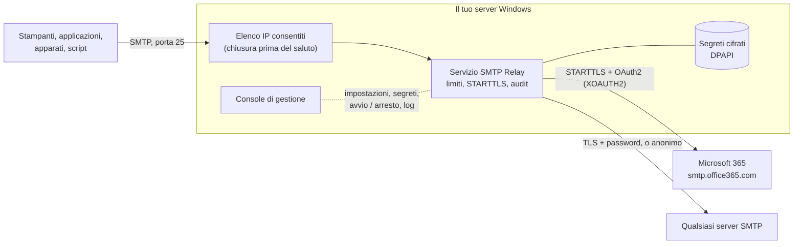

<p align="center">
  <picture>
    <source media="(prefers-color-scheme: dark)" srcset="assets/brand/Logo_SmtpRelay_White.png">
    
  </picture>
</p>

<h3 align="center">Il relay SMTP che Windows Server avrebbe dovuto avere.</h3>

<p align="center">
  Un sostituto moderno del relay SMTP di IIS 6: stampanti, applicazioni e apparati continuano a inviare in SMTP semplice,<br>
  il relay inoltra tutto a Microsoft 365 con OAuth2, o a qualsiasi server SMTP. Un setup, una console, nessuno script.
</p>

<p align="center">
  <a href="https://github.com/NEXQsrl/SMTP-Relay/releases/latest"><b>Scarica l'ultima versione</b></a> ·
  <a href="#installazione-in-cinque-minuti">Installazione</a> ·
  <a href="#funzionalità">Funzionalità</a> ·
  <a href="#configurazione-di-microsoft-365">Microsoft 365</a> ·
  <a href="README.md">English</a>
</p>

<p align="center">
  
  
  
  
  
  <a href="LICENSE"></a>
</p>

<p align="center">
  
</p>

## Perché SMTP Relay

Stampanti multifunzione, gestionali, NAS, sistemi di monitoraggio e vecchie applicazioni inviano ancora la posta in
SMTP semplice, spesso senza TLS e senza autenticazione moderna. Microsoft 365 non lo accetta più, e la risposta
abituale, il servizio SMTP di IIS 6, è deprecato, non supporta OAuth2 e si gestisce da una console del 2003.

SMTP Relay si mette tra quegli apparati e il sistema di posta:

- **Gli apparati restano come sono.** Inviano al relay sulla porta 25 (o su quella che scegli), senza password. Chi
  può inviare lo decide il relay, in base all'indirizzo IP.
- **Microsoft 365 con autenticazione moderna.** Il relay accede con una registrazione di app (OAuth2 client
  credentials, XOAUTH2). Nessuna password di casella è salvata, e l'autenticazione di base può restare disattivata
  nel tenant.
- **Oppure qualsiasi altro server.** Utente e password su TLS, o nessuna autenticazione per un connettore Exchange
  che si fida del tuo IP pubblico.
- **Mai un open relay.** Con l'elenco degli IP vuoto il relay rifiuta tutti. Una connessione da un indirizzo non
  consentito viene chiusa prima del saluto SMTP: il relay non rivela nemmeno di essere un server di posta.
- **I segreti sono cifrati.** Password e client secret sono protetti con Windows DPAPI e legati al computer. Non
  vengono mai scritti nel file delle impostazioni né mostrati di nuovo.
- **Sai cosa è successo a ogni messaggio.** Una riga di audit per messaggio (chi, da, a, dimensione, oggetto, esito),
  un log applicativo a rotazione, il registro eventi di Windows e una copia di ogni messaggio non consegnato.
- **Un vero setup e una vera console.** Un programma di installazione firmato registra il servizio e la regola del
  firewall. Una console grafica configura tutto, prova la connessione, mostra i log e installa gli aggiornamenti da
  GitHub.

## Come si presenta

<table>
  <tr>
    <td width="50%"><br><b>Smart host</b>: Microsoft 365 con OAuth2, utente e password, oppure nessuna autenticazione. Il segreto si salva cifrato con un clic; <i>Test connection</i> e <i>Send a test message</i> usano le impostazioni a schermo.</td>
    <td width="50%"><br><b>Allowed senders</b>: indirizzi singoli e reti CIDR, IPv4 e IPv6. Tutto il resto viene disconnesso prima del saluto.</td>
  </tr>
  <tr>
    <td width="50%"><br><b>Logs</b>: l'audit delle consegne e il log applicativo, in tempo reale, con filtro per indirizzo, oggetto o esito.</td>
    <td width="50%"><br><b>Aggiornamenti</b>: la console trova una versione più recente su GitHub e la installa dopo averne controllato lo SHA-256 e la firma NEXQ. Le impostazioni restano.</td>
  </tr>
  <tr>
    <td width="50%"><br><b>Inbound TLS</b>: STARTTLS offerto o obbligatorio per i client, con un certificato dello store di Windows o un file .pfx. Minimo TLS 1.2.</td>
    <td width="50%"><br><b>Logging & retention</b>: livello di dettaglio, rotazione per giorno e per dimensione, per quanto tempo conservare log e messaggi non consegnati.</td>
  </tr>
</table>

<sub>Le immagini mostrano l'interfaccia reale della versione 2.0.0 con dati di esempio (indirizzi, tenant e messaggi sono esempi). L'interfaccia è in inglese.</sub>

## Funzionalità

### Ricezione
- **Listener SMTP** sull'indirizzo e sulla porta che scegli (25 per impostazione predefinita), con limiti su
  dimensione dei messaggi, destinatari per messaggio, sessioni contemporanee e tempo di inattività.
- **Elenco degli IP consentiti** con indirizzi singoli e reti CIDR (IPv4 e IPv6), applicato a livello di
  connessione. Fail-closed: con l'elenco vuoto ogni connessione è rifiutata, a meno che tu non lo disattivi
  esplicitamente.
- **STARTTLS per i client**, facoltativo o obbligatorio, solo TLS 1.2 o 1.3, con un certificato in `LocalMachine\My`
  (consigliato) o un file `.pfx` la cui password è nello store cifrato.

### Inoltro
- **Microsoft 365** con OAuth2 client credentials (XOAUTH2). I token sono in cache e rinnovati automaticamente; un
  client secret ruotato viene usato senza riavviare il servizio.
- **Qualsiasi server SMTP** con utente e password, oppure **senza autenticazione**.
- **La cifratura verso lo smart host è imposta**: STARTTLS o TLS implicito. Le credenziali non vengono mai inviate
  su una connessione non cifrata, anche se il server smette di offrire STARTTLS, a meno che tu non lo consenta
  esplicitamente.
- **Nuovi tentativi** con ritardo crescente sugli errori temporanei. Il client riceve `250` quando lo smart host ha
  accettato il messaggio, `451` quando deve riprovare, `554` quando il messaggio è stato rifiutato in modo definitivo.
- **Mittente fisso** (facoltativo): sostituisce il mittente di busta di ogni messaggio, per i server che accettano
  un solo indirizzo.

### Sicurezza
- **Segreti cifrati**: DPAPI (ambito macchina) più una chiave casuale per installazione. I file sono legati al
  computer e non possono essere copiati su un altro.
- **Cartella dati protetta**: log, messaggi non consegnati e segreti sono leggibili solo da SYSTEM e Administrators.
- **File firmati**: il setup, il programma di disinstallazione e ogni file del programma sono firmati da NEXQ S.r.l.
- **Aggiornamenti verificati**: SHA-256 da GitHub e firma NEXQ, prima di eseguire qualsiasi cosa.
- **Nessuna telemetria.** Il servizio contatta solo il tuo smart host (e il servizio di accesso di Microsoft in
  modalità Microsoft 365). La console contatta GitHub solo per cercare una versione più recente, e puoi disattivarlo.

### Gestione
- **Console grafica** in inglese per ogni impostazione, con controllo mentre scrivi e avvisi chiari (open relay,
  credenziali in chiaro, segreto mancante).
- **Audit delle consegne**: una riga per messaggio, in un file dedicato, protetta dalla falsificazione dei log (gli
  a capo in oggetti e indirizzi vengono rimossi).
- **Log** con rotazione giornaliera e per dimensione e conservazione automatica, più avvisi ed errori nel registro
  eventi Applicazione di Windows (origine `SmtpRelay`) per il tuo sistema di monitoraggio.
- **Messaggi non consegnati** salvati come `.eml`, eliminati automaticamente dopo i giorni che scegli.
- **Riga di comando** per l'automazione: installazione, avvio, arresto, credenziali, test della connessione,
  controllo della configurazione.
- **Riavvio automatico** del servizio dopo un arresto anomalo.

## Installazione in cinque minuti

Serve un Windows Server (o Windows 10/11) raggiungibile dai tuoi apparati, e i diritti di amministratore.
Nient'altro: il runtime .NET è incluso nel setup.

**1. Scarica** `SmtpRelay-Setup-2.0.0.exe` dall'
[ultima versione](https://github.com/NEXQsrl/SMTP-Relay/releases/latest). La release elenca lo SHA-256 di ogni file
(`SHA256SUMS.txt`): controllalo con `Get-FileHash .\SmtpRelay-Setup-2.0.0.exe -Algorithm SHA256`.

**2. Considera attendibile la firma (una volta per server).** I file sono firmati da *NEXQ S.r.l.* con un
certificato autofirmato. Windows lo considera attendibile solo dopo che lo hai importato. Il certificato pubblico è
dentro la firma del file; estrailo, controlla che l'identificazione personale (thumbprint) sia
`989A5C82203AB19B6DB29FC447E8CB5EBEEB60D8`, poi importalo (PowerShell come amministratore):

```powershell
$cert = (Get-AuthenticodeSignature .\SmtpRelay-Setup-2.0.0.exe).SignerCertificate
$cert.Thumbprint          # deve essere 989A5C82203AB19B6DB29FC447E8CB5EBEEB60D8
Export-Certificate -Cert $cert -FilePath .\NEXQ-CodeSigning.cer | Out-Null
Import-Certificate -FilePath .\NEXQ-CodeSigning.cer -CertStoreLocation Cert:\LocalMachine\Root
Import-Certificate -FilePath .\NEXQ-CodeSigning.cer -CertStoreLocation Cert:\LocalMachine\TrustedPublisher
```

Da quel momento Windows mostra *Autore verificato: NEXQ S.r.l.* quando avvii il setup. Se qualcosa lo blocca ancora,
vedi [Antivirus, SmartScreen e firma](#antivirus-smartscreen-e-firma).

**3. Avvia il setup.** Installa il programma in `C:\Program Files\NEXQ\SMTP Relay`, registra il servizio Windows
*NEXQ SMTP Relay* (senza ancora avviarlo), aggiunge la regola del firewall e apre la console.

**4. Configura.** Nella console:

| Pagina | Cosa impostare |
|---|---|
| **Allowed senders** | Gli indirizzi IP o le reti dei tuoi apparati, ad esempio `192.168.10.0/24`. |
| **Smart host** | *Microsoft 365* (vedi [sotto](#configurazione-di-microsoft-365)), oppure host, porta e credenziali del tuo server. Scrivi il segreto e premi **Store**. |
| **Listener** | La porta, se non vuoi la 25. |

Premi **Test connection**, poi **Send a test message**.

**5. Avvia.** Premi **Save and restart service** (oppure **Start** nella pagina Overview). La pagina Overview deve
mostrare *Running*.

**6. Punta gli apparati** al nome o all'indirizzo IP di questo server, porta 25, senza autenticazione e senza TLS
(o con STARTTLS se hai configurato un certificato). Ogni messaggio compare nella pagina **Logs** in pochi secondi.

> **Stai sostituendo il servizio SMTP di IIS?** Due programmi non possono ascoltare sulla stessa porta. Arresta e
> disattiva *Simple Mail Transfer Protocol (SMTP)* nella console Servizi (o rimuovi la funzionalità Server SMTP)
> prima di avviare il relay, oppure tieni il relay su un'altra porta durante la migrazione. Se la porta è occupata,
> il relay lo scrive nel log e si arresta.

### Installazione automatica

```powershell
.\SmtpRelay-Setup-2.0.0.exe /VERYSILENT /SUPPRESSMSGBOXES /NORESTART /LOG="C:\Temp\smtprelay-setup.log"
```

Poi copia il tuo `appsettings.json` nella cartella di installazione, salva il segreto e avvia il servizio:

```powershell
cd "C:\Program Files\NEXQ\SMTP Relay"
.\SmtpRelay.exe set-credential --name M365ClientSecret      # chiede il valore; oppure passalo con --stdin
.\SmtpRelay.exe test-upstream
.\SmtpRelay.exe start
```

### Requisiti

| Componente | Requisito |
|---|---|
| Sistema operativo | Windows Server 2016 o successivo, Windows 10 o 11, 64 bit |
| .NET | Niente da installare: la release è self-contained (.NET 10) |
| Diritti | Amministratore, per installare e per usare la console |
| Rete in ingresso | La porta di ascolto (25 per impostazione predefinita) dai tuoi apparati |
| Rete in uscita | Il tuo smart host (Microsoft 365: `smtp.office365.com:587` e `login.microsoftonline.com:443`) |
| Internet | Non necessario al servizio oltre allo smart host. La console contatta `api.github.com` per gli aggiornamenti (facoltativo) |

## Configurazione di Microsoft 365

Il relay accede a Exchange Online come applicazione. Si fa una volta sola, in circa dieci minuti.

1. **Registra l'applicazione.** Nell'[interfaccia di amministrazione di Microsoft Entra](https://entra.microsoft.com)
   apri *Registrazioni app > Nuova registrazione*. Un nome qualsiasi (ad esempio `SMTP Relay`), singolo tenant,
   nessun URI di reindirizzamento. Annota l'**ID applicazione (client)** e l'**ID directory (tenant)**.
2. **Aggiungi l'autorizzazione.** *Autorizzazioni API > Aggiungi un'autorizzazione > API usate dall'organizzazione >
   Office 365 Exchange Online > Autorizzazioni applicazione > `SMTP.SendAsApp`*. Poi premi **Concedi consenso
   amministratore**.
3. **Crea un client secret.** *Certificati e segreti > Nuovo segreto client*. Copia subito il **Valore**: viene
   mostrato una volta sola.
4. **Registra l'entità servizio in Exchange Online** e dalle accesso alla casella mittente (Exchange Online
   PowerShell). L'ID oggetto è quello dell'applicazione sotto *Applicazioni aziendali*, non quello sotto
   *Registrazioni app*:

   ```powershell
   Connect-ExchangeOnline
   New-ServicePrincipal -AppId <id-applicazione-client> -ObjectId <id-oggetto-applicazione-aziendale>
   Add-MailboxPermission -Identity relay@contoso.com -User <id-oggetto-applicazione-aziendale> -AccessRights FullAccess
   Set-CASMailbox -Identity relay@contoso.com -SmtpClientAuthenticationDisabled $false
   ```

5. **Compila la console**: tenant, ID client, casella mittente, poi scrivi il client secret e premi **Store**.
   Premi **Test connection**.

I messaggi vengono inviati come la casella mittente. Per permettere agli apparati di usare altri indirizzi mittente,
concedi alla casella mittente l'autorizzazione *Invia come* su quegli indirizzi, oppure imposta **Always send as**
nella console per riscrivere il mittente di busta.

I client secret scadono (al massimo dopo 24 mesi). Quando ne crei uno nuovo, salvalo nella console: il servizio in
esecuzione lo usa dal messaggio successivo, senza riavvio.

## Antivirus, SmartScreen e firma

Ogni eseguibile e libreria di SMTP Relay, il setup e il programma di disinstallazione sono firmati da
**NEXQ S.r.l.** con marca temporale. Il certificato è **autofirmato**: dimostra che i file provengono da NEXQ e non
sono stati alterati, ma nessuna autorità pubblica lo garantisce, quindi Windows e i prodotti di sicurezza non lo
conoscono finché non glielo dici tu.

| Cosa vedi | Perché | Cosa fare |
|---|---|---|
| *Autore sconosciuto* nella richiesta UAC | Il certificato non è ancora attendibile su questo computer | Importalo come al [passo 2](#installazione-in-cinque-minuti). La richiesta mostrerà *Autore verificato: NEXQ S.r.l.* |
| *PC protetto da Windows* (SmartScreen) | Il file è stato scaricato da Internet e non ha reputazione; una firma autofirmata non ne costruisce | *Ulteriori informazioni > Esegui comunque*, oppure esegui prima `Unblock-File .\SmtpRelay-Setup-2.0.0.exe` dopo averne controllato lo SHA-256 |
| *Accesso negato* all'avvio del setup o dei programmi, evento 1121 di Microsoft Defender | La regola di riduzione della superficie di attacco *Blocca l'esecuzione dei file eseguibili a meno che non soddisfino un criterio di prevalenza, età o elenco attendibile* blocca qualsiasi programma nuovo | Aggiungi un'esclusione (sotto), oppure in Microsoft Defender per endpoint crea un indicatore **Consenti** per il certificato |
| L'antivirus mette in quarantena o blocca un file | Euristiche su un programma nuovo, poco diffuso, che ascolta su una porta | Controlla lo SHA-256 con quello della release, poi consenti il certificato dell'autore o escludi la cartella di installazione |

Esclusione per le regole di riduzione della superficie di attacco di Microsoft Defender (PowerShell come
amministratore; la prima riga serve solo mentre esegui il setup):

```powershell
Add-MpPreference -AttackSurfaceReductionOnlyExclusions "C:\Install\SmtpRelay-Setup-2.0.0.exe"
Add-MpPreference -AttackSurfaceReductionOnlyExclusions "C:\Program Files\NEXQ\SMTP Relay"
```

Per molti server, distribuisci il certificato con un Criterio di gruppo: *Configurazione computer > Criteri >
Impostazioni di Windows > Impostazioni sicurezza > Criteri chiave pubblica*, importa `NEXQ-CodeSigning.cer`
(allegato a ogni release) sia in **Autorità di certificazione radice attendibili** sia in **Autori attendibili**.

Verifica sempre prima di fidarti: il thumbprint deve essere `989A5C82203AB19B6DB29FC447E8CB5EBEEB60D8`
(SHA-256 `C03E2BA2CF4C3F22776CF744D32261289B7E586C70B9CA8FC7846B578C8AB3E7`). Importare un certificato tra le *Radici
attendibili* è una decisione di sicurezza: fallo solo per un certificato di cui hai confrontato il thumbprint con
questa pagina.

## Come funziona



- Il **servizio** (`SmtpRelay.exe`) accetta un messaggio solo da un indirizzo consentito, lo inoltra subito e
  risponde al client con l'esito. Non tiene una coda: quando lo smart host non è raggiungibile il client riceve `451`
  e riprova, e una copia del messaggio viene salvata come `.eml`.
- La **console** (`SmtpRelayManager.exe`) modifica `appsettings.json`, salva i segreti, controlla il servizio e
  legge i log. Viene sempre eseguita come amministratore.
- Le **impostazioni** sono in `C:\Program Files\NEXQ\SMTP Relay\appsettings.json`. I **dati** (log, segreti, messaggi
  non consegnati) sono in `C:\ProgramData\SmtpRelay`. Aggiornamenti e riparazioni non toccano né le une né gli altri.

## Log

Tutto si trova in `C:\ProgramData\SmtpRelay\logs` (la cartella si può cambiare) e nella pagina **Logs** della console.

| File | Contenuto |
|---|---|
| `audit-AAAAMMGG.log` | Una riga per messaggio: `DELIVERED` o `FAILED`, indirizzo del client, mittente, destinatari, dimensione, oggetto, durata o motivo |
| `smtp-relay-AAAAMMGG.log` | Log applicativo: avvio e arresto, connessioni rifiutate, nuovi tentativi, errori con i dettagli |
| `manager-AAAAMM.log` | Cosa hanno fatto gli amministratori nella console: impostazioni salvate, segreti modificati, servizio avviato o arrestato, aggiornamenti |
| Registro eventi di Windows | Avvisi ed errori, registro *Applicazione*, origine `SmtpRelay` |
| `..\failed\*.eml` | Una copia di ogni messaggio non consegnato, per la diagnosi o per reinviarlo a mano |

```
2026-11-11 10:38:40.106 +01:00 DELIVERED client=10.20.4.12 from=erp@contoso.com to=orders@fabrikam.com size=24110 subject=Order confirmation 55012 durationMs=655
2026-11-11 10:42:07.118 +01:00 FAILED client=192.168.10.44 from=scanner@contoso.com to=m.rossi@fabrikam.com size=4821330 subject=Scan 0042 permanent=True reason=5.7.60 Client does not have permissions to send as this sender
```

Un nuovo file inizia ogni giorno e quando si raggiunge il limite di dimensione; i file più vecchi del periodo di
conservazione vengono eliminati automaticamente (31 giorni per impostazione predefinita). Gli oggetti dei messaggi
fanno parte della riga di audit: se nella tua organizzazione non è accettabile, limita ulteriormente l'accesso alla
cartella o disattiva l'audit.

## Riferimento della configurazione

La console scrive `appsettings.json` per te. Ogni impostazione si può anche definire con una variabile di ambiente
`SMTPRELAY_SmtpRelay__<Sezione>__<Nome>`. Le modifiche vengono lette all'avvio del servizio.

| Impostazione | Predefinito | Significato |
|---|---|---|
| `Listener.IpAddress` / `Port` | `0.0.0.0` / `25` | Dove ascolta il relay |
| `Listener.ServerName` | `smtp-relay` | Nome nel saluto SMTP |
| `Listener.MaxMessageSizeBytes` | `26214400` | Messaggio più grande accettato (25 MB) |
| `Listener.MaxRecipients` | `100` | Destinatari per messaggio |
| `Listener.MaxConcurrentSessions` | `50` | Sessioni servite contemporaneamente |
| `Security.AllowedIps` | `127.0.0.1`, `::1` | Indirizzi e reti CIDR che possono inviare |
| `Security.RejectWhenAllowListEmpty` | `true` | Con l'elenco vuoto rifiuta tutti |
| `Tls.Mode` | `None` | `None`, `StartTlsOptional`, `StartTlsRequired` |
| `Tls.CertificateThumbprint` / `CertificatePath` | vuoto | Certificato per STARTTLS |
| `Upstream.Mode` | `Microsoft365` | `Microsoft365`, `Basic`, `Anonymous` |
| `Upstream.Host` / `Port` / `Security` | `smtp.office365.com` / `587` / `StartTls` | Lo smart host. Sicurezza: `StartTls`, `SslOnConnect`, `Auto`, `StartTlsWhenAvailable`, `None` |
| `Upstream.AllowInsecureAuthentication` | `false` | Consente le credenziali su una connessione che potrebbe essere in chiaro |
| `Upstream.MaxAttempts` / `RetryBaseDelaySeconds` | `3` / `5` | Nuovi tentativi sugli errori temporanei |
| `Upstream.OverrideFromAddress` | vuoto | Mittente di busta fisso |
| `Upstream.Microsoft365.*` | | `TenantId`, `ClientId`, `SenderUsername`, `ClientSecretName` |
| `Upstream.Basic.*` | | `Username`, `PasswordSecret` |
| `Logging.MinimumLevel` | `Information` | Da `Verbose` a `Fatal` |
| `Logging.RetainedFileTimeLimitDays` / `RetainedFileCountLimit` | `31` / `31` | Conservazione |
| `Logging.AuditTrail` / `EventLog` | `true` / `true` | File di audit e registro eventi di Windows |
| `Delivery.SpoolFailedMessages` / `FailedSpoolRetentionDays` | `true` / `30` | Copie dei messaggi non consegnati |
| `Updates.CheckOnStartup` | `true` | La console cerca una versione più recente all'apertura |

I segreti (`M365ClientSecret`, `UpstreamPassword`, `TlsCertPassword`) non sono mai in questo file: le impostazioni
contengono solo il *nome* del segreto, il valore è nello store cifrato.

### Riga di comando

`SmtpRelay.exe` nella cartella di installazione (prompt come amministratore):

| Comando | Cosa fa |
|---|---|
| `install [--account <utente> --password-stdin]` | Registra o ripara il servizio (LocalSystem per impostazione predefinita), protegge la cartella dati |
| `uninstall` | Rimuove il servizio |
| `start` · `stop` · `restart` · `status` | Controlla il servizio (`status` restituisce 0 quando è in esecuzione) |
| `set-credential --name <nome> [--stdin]` | Salva un segreto, cifrato |
| `remove-credential --name <nome>` · `list-credentials` | Rimuove un segreto · elenca i nomi (mai i valori) |
| `test-upstream` | Si connette e accede allo smart host |
| `show-config` | Mostra la configurazione effettiva, gli avvisi e gli errori |

## Aggiornamento e rimozione

**Aggiornamento.** Quando su GitHub c'è una versione più recente la console mostra *Update available*. *About &
updates > Download and install* scarica il setup, confronta il suo SHA-256 con quello pubblicato da GitHub, controlla
che sia firmato da NEXQ S.r.l., poi lo installa: il relay si ferma per circa un minuto e riparte. Impostazioni,
segreti e log restano. Puoi anche eseguire a mano un setup più recente; il risultato è lo stesso.

**Rimozione.** *Impostazioni > App* (o *Programmi e funzionalità*) > *NEXQ SMTP Relay* > *Disinstalla*. Il servizio
e la regola del firewall vengono rimossi. Il setup chiede se eliminare anche impostazioni, segreti e log; per
impostazione predefinita vengono conservati.

## Stato del progetto

La versione 2.0.0 è la prima con il setup, la console e il meccanismo di aggiornamento. Il relay vero e proprio
(elenco IP, limiti, inoltro, nuovi tentativi, audit, segreti) e la verifica degli aggiornamenti sono coperti da una
suite di test automatici che esegue il listener reale contro uno smart host di prova. Il setup, la registrazione del
servizio, la regola del firewall e l'aggiornamento dalla console sono stati compilati e verificati come pacchetti
firmati, ma **non sono ancora stati validati dall'inizio alla fine su ogni versione di Windows supportata**:
installa prima su un server di prova e tieni il relay precedente finché non hai visto i tuoi apparati consegnare
attraverso questo. SMTP Relay non ha avuto una revisione di sicurezza indipendente.

Non esporre la porta di ascolto a Internet. Il relay è pensato per una rete interna, dietro il tuo firewall.

## Compilazione dai sorgenti

Prerequisiti: Windows, .NET SDK 10 e [Inno Setup 6](https://jrsoftware.org/isinfo.php) per il setup.

```powershell
dotnet build SMTPRelay.slnx
dotnet test SMTPRelay.slnx
dotnet run --project src/SmtpRelay.Service                 # il relay nella console, sulla porta 2525
dotnet run --project src/SmtpRelay.Manager                 # la console di gestione (Debug: senza elevazione)

# release: file self-contained, firme, setup, zip e checksum in artifacts\release
dotnet msbuild build\Release.proj -restore -t:Release -p:SignThumbprint=<thumbprint del tuo certificato di firma del codice>
```

| Cartella | Contenuto |
|---|---|
| `src/SmtpRelay.Core` | Configurazione, validazione, segreti, elenco IP, consegna allo smart host |
| `src/SmtpRelay.Service` | Il servizio Windows e la riga di comando |
| `src/SmtpRelay.Manager` | La console di gestione (WPF) |
| `tests/SmtpRelay.Tests` | Test unitari ed end-to-end |
| `installer` · `build` | Script di Inno Setup · build della release |

## Sicurezza

Elenco IP fail-closed, cifratura imposta verso lo smart host, segreti cifrati e legati al computer, cartella dati
chiusa agli utenti ordinari, file firmati, aggiornamenti verificati, nessuna telemetria. I dettagli e i limiti sono
in [SECURITY_IT.md](SECURITY_IT.md). **Per segnalare una vulnerabilità non aprire una issue pubblica**: segui
[SECURITY_IT.md](SECURITY_IT.md).

## Contribuire

Leggi prima [CONTRIBUTING.md](CONTRIBUTING.md). In breve: non indebolire mai un'impostazione fail-closed, non
scrivere mai un segreto o il corpo di un messaggio in un log, tieni ogni testo dell'interfaccia in inglese chiaro e
aggiungi un test per ciò che modifichi.

## Licenza

SMTP Relay è sviluppato da [NEXQ](https://www.nexq.it/?utm_source=github&utm_medium=referral&utm_campaign=smtprelay) e
rilasciato con la **[PolyForm Shield License 1.0.0](https://polyformproject.org/licenses/shield/1.0.0)**
([LICENSE](LICENSE)), una licenza standard di tipo source-available:

- **Gratuito per uso personale e aziendale**, anche in produzione, senza limiti di server, apparati, caselle o
  messaggi.
- **Il codice sorgente è pubblico**: puoi studiarlo, modificarlo, basarti su di esso e distribuirne copie con la
  licenza e la riga `Required Notice`.
- **Non è consentito rivendere SMTP Relay**: la licenza vieta di fornire qualsiasi prodotto in concorrenza con esso,
  quindi non è consentito venderlo, vendere versioni modificate o rinominate, né offrirlo come prodotto o servizio
  concorrente.
- **Diritti commerciali aggiuntivi**: contatta NEXQ tramite [www.nexq.it](https://www.nexq.it/?utm_source=github&utm_medium=referral&utm_campaign=smtprelay).

Non è una licenza open source approvata da OSI (GitHub la mostra come "Other"). I componenti di terze parti
mantengono le proprie licenze: vedi [NOTICE](NOTICE).

Copyright (c) NEXQ S.r.l. · [www.nexq.it](https://www.nexq.it/?utm_source=github&utm_medium=referral&utm_campaign=smtprelay)

"Microsoft 365", "Exchange", "Windows Server" e "Microsoft Entra" sono marchi del gruppo di società Microsoft.
SMTP Relay è un progetto indipendente e non è affiliato a Microsoft né da essa approvato.
