<p align="center">
  <picture>
    <source media="(prefers-color-scheme: dark)" srcset="assets/brand/Logo_SmtpRelay_White.png">
    
  </picture>
</p>

<h3 align="center">Il relay SMTP che Windows Server avrebbe dovuto avere.</h3>

<p align="center">
  Un sostituto moderno del relay SMTP di IIS 6: stampanti, applicazioni e apparati continuano a inviare in SMTP semplice,<br>
  il relay inoltra tutto a Microsoft 365 con OAuth2, o a qualsiasi server SMTP. Un setup, una console, nessuno script.
</p>

<p align="center">
  <a href="https://github.com/NEXQsrl/SMTP-Relay/releases/latest"><b>Scarica l'ultima versione</b></a> ·
  <a href="#installazione-in-cinque-minuti">Installazione</a> ·
  <a href="#funzionalità">Funzionalità</a> ·
  <a href="#configurazione-di-microsoft-365">Microsoft 365</a> ·
  <a href="README.md">English</a>
</p>

<p align="center">
  
  
  
  
  
  <a href="LICENSE"></a>
</p>

<p align="center">
  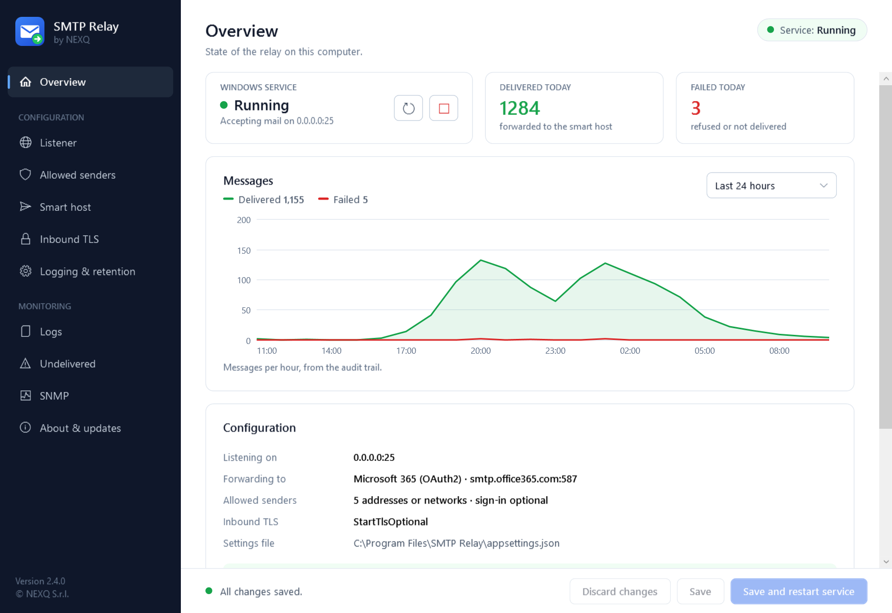
</p>

## Perché SMTP Relay

Stampanti multifunzione, gestionali, NAS, sistemi di monitoraggio e vecchie applicazioni inviano ancora la posta in
SMTP semplice, spesso senza TLS e senza autenticazione moderna. Microsoft 365 non lo accetta più, e la risposta
abituale, il servizio SMTP di IIS 6, è deprecato, non supporta OAuth2 e si gestisce da una console del 2003.

SMTP Relay si mette tra quegli apparati e il sistema di posta:

- **Gli apparati restano come sono.** Inviano al relay sulla porta 25 (o su quella che scegli), senza password. Chi
  può inviare lo decide il relay, in base all'indirizzo IP.
- **Microsoft 365 con autenticazione moderna.** Il relay accede con una registrazione di app (OAuth2 client
  credentials, XOAUTH2). Nessuna password di casella è salvata, e l'autenticazione di base può restare disattivata
  nel tenant.
- **Oppure qualsiasi altro server.** Utente e password su TLS, o nessuna autenticazione per un connettore Exchange
  che si fida del tuo IP pubblico.
- **Mai un open relay.** Con l'elenco degli IP vuoto il relay rifiuta tutti. Una connessione da un indirizzo non
  consentito viene chiusa prima del saluto SMTP: il relay non rivela nemmeno di essere un server di posta.
- **I segreti sono cifrati.** Password e client secret sono protetti con Windows DPAPI e legati al computer. Non
  vengono mai scritti nel file delle impostazioni né mostrati di nuovo.
- **Sai cosa è successo a ogni messaggio.** Una riga di audit per messaggio (chi, da, a, dimensione, oggetto, esito),
  un log applicativo a rotazione, il registro eventi di Windows e una copia di ogni messaggio non consegnato.
- **Un vero setup e una vera console.** Un programma di installazione firmato registra il servizio e la regola del
  firewall. Una console grafica configura tutto, prova la connessione, mostra i log e installa gli aggiornamenti da
  GitHub.

## Come si presenta

<table>
  <tr>
    <td width="50%">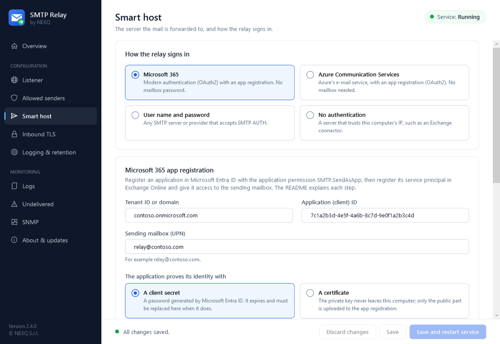<br><b>Smart host</b>: Microsoft 365 o Azure Communication Services con OAuth2 (client secret o certificato), utente e password, oppure nessuna autenticazione. Il segreto si salva cifrato con un clic; <i>Test connection</i> e <i>Send a test message</i> usano le impostazioni a schermo.</td>
    <td width="50%">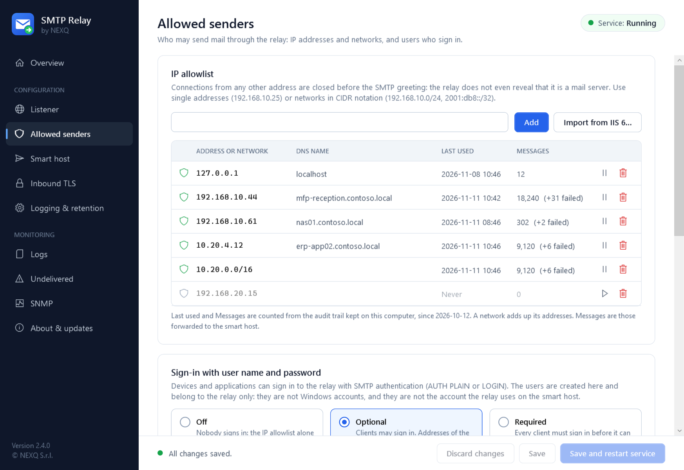<br><b>Allowed senders</b>: indirizzi e reti CIDR, più gli utenti propri del relay per gli apparati che si autenticano. L'elenco si può importare da IIS 6.</td>
  </tr>
  <tr>
    <td width="50%">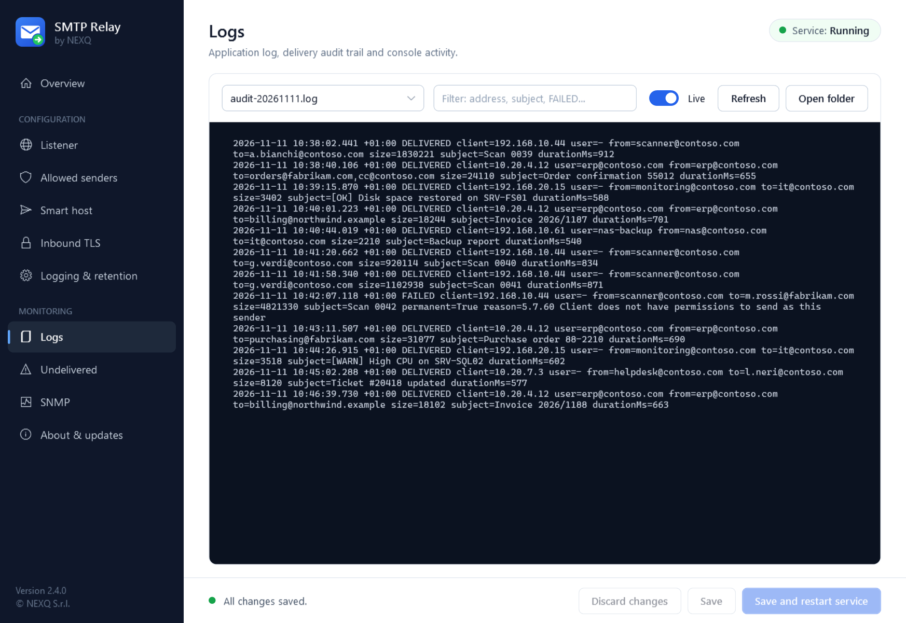<br><b>Logs</b>: l'audit delle consegne e il log applicativo, in tempo reale, con filtro per indirizzo, oggetto o esito.</td>
    <td width="50%">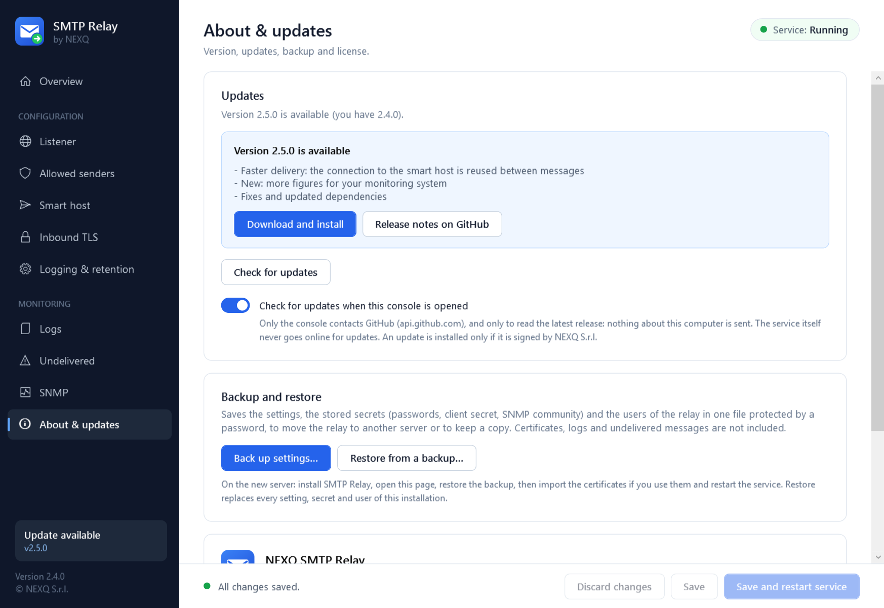<br><b>Aggiornamenti</b>: la console trova una versione più recente su GitHub e la installa dopo averne controllato lo SHA-256 e la firma NEXQ. Le impostazioni restano.</td>
  </tr>
  <tr>
    <td width="50%">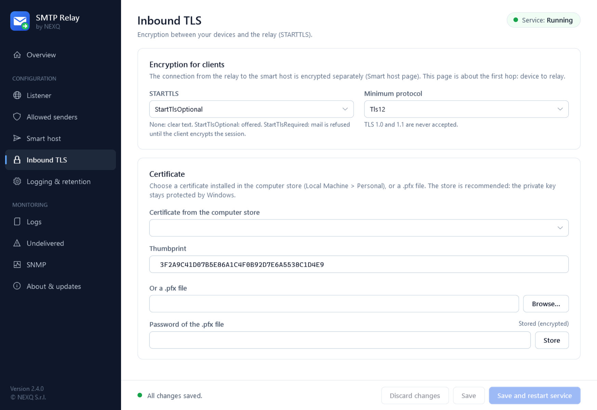<br><b>Inbound TLS</b>: STARTTLS offerto o obbligatorio per i client, con un certificato dello store di Windows o un file .pfx. Minimo TLS 1.2.</td>
    <td width="50%">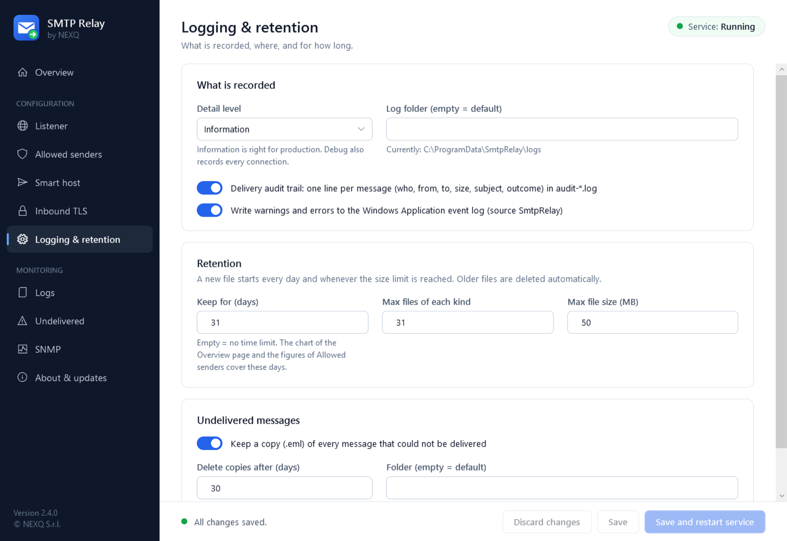<br><b>Logging & retention</b>: livello di dettaglio, rotazione per giorno e per dimensione, per quanto tempo conservare log e messaggi non consegnati.</td>
  </tr>
  <tr>
    <td width="50%">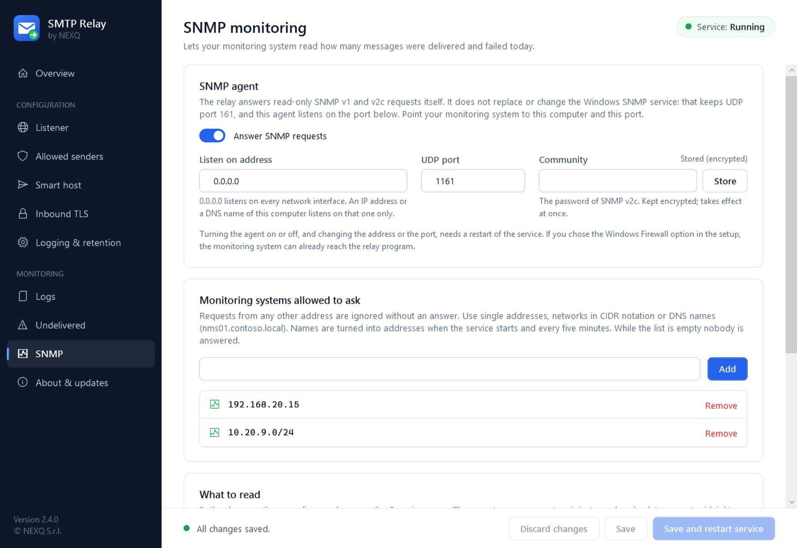<br><b>SNMP</b>: il sistema di monitoraggio legge i messaggi consegnati e falliti oggi. Sola lettura, con community conservata cifrata e un elenco dei sistemi di monitoraggio ammessi.</td>
    <td width="50%">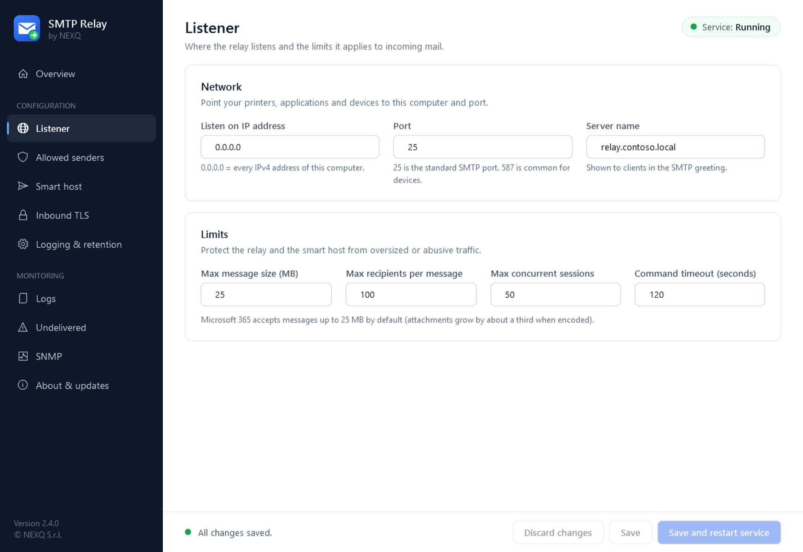<br><b>Listener</b>: indirizzo, porta e limiti applicati alla posta in ingresso.</td>
  </tr>
</table>

<sub>Le immagini mostrano l'interfaccia reale della versione 2.4.0 con dati di esempio (indirizzi, tenant e messaggi sono esempi). L'interfaccia è in inglese.</sub>

## Funzionalità

### Ricezione
- **Listener SMTP** sull'indirizzo e sulla porta che scegli (25 per impostazione predefinita), con limiti su
  dimensione dei messaggi, destinatari per messaggio, sessioni contemporanee e tempo di inattività.
- **Elenco degli IP consentiti** con indirizzi singoli e reti CIDR (IPv4 e IPv6), applicato a livello di
  connessione. Fail-closed: con l'elenco vuoto ogni connessione è rifiutata, a meno che tu non lo disattivi
  esplicitamente.
- **Accesso con nome utente e password** (SMTP AUTH PLAIN e LOGIN), disattivato per impostazione predefinita,
  facoltativo o obbligatorio. Gli utenti si creano nella console e appartengono al relay: non sono account di
  Windows. Di ogni password si conserva solo un hash con salt.
- **Importazione da IIS 6**: un pulsante copia nell'elenco i computer delle *Restrizioni di inoltro* del server
  virtuale SMTP di IIS.
- **STARTTLS per i client**, facoltativo o obbligatorio, solo TLS 1.2 o 1.3, con un certificato in `LocalMachine\My`
  (consigliato) o un file `.pfx` la cui password è nello store cifrato.

### Inoltro
- **Microsoft 365** con OAuth2 client credentials (XOAUTH2). I token sono in cache e rinnovati automaticamente; un
  client secret ruotato viene usato senza riavviare il servizio.
- **Qualsiasi server SMTP** con utente e password, oppure **senza autenticazione**.
- **Azure Communication Services** (Email) via SMTP con OAuth2: il relay accede come applicazione Microsoft Entra,
  senza casella di posta e senza password nelle impostazioni.
- **Client secret o certificato** per l'applicazione Microsoft Entra, in entrambe le modalità Microsoft. Con il
  certificato la chiave privata resta nell'archivio certificati di Windows del server; la console ne crea uno per te.
- **La cifratura verso lo smart host è imposta**: STARTTLS o TLS implicito. Le credenziali non vengono mai inviate
  su una connessione non cifrata, anche se il server smette di offrire STARTTLS, a meno che tu non lo consenta
  esplicitamente.
- **Nuovi tentativi** con ritardo crescente sugli errori temporanei. Il client riceve `250` quando lo smart host ha
  accettato il messaggio, `451` quando deve riprovare, `554` quando il messaggio è stato rifiutato in modo definitivo.
- **Mittente fisso** (facoltativo): sostituisce il mittente di busta di ogni messaggio, per i server che accettano
  un solo indirizzo.

### Sicurezza
- **Segreti cifrati**: DPAPI (ambito macchina) più una chiave casuale per installazione. I file sono legati al
  computer e non possono essere copiati su un altro.
- **Cartella dati protetta**: log, messaggi non consegnati e segreti sono leggibili solo da SYSTEM e Administrators.
- **File firmati**: il setup, il programma di disinstallazione e ogni file del programma sono firmati da NEXQ S.r.l.
- **Aggiornamenti verificati**: SHA-256 da GitHub e firma NEXQ, prima di eseguire qualsiasi cosa.
- **Nessuna telemetria.** Il servizio contatta solo il tuo smart host (e il servizio di accesso di Microsoft in
  modalità Microsoft 365). La console contatta GitHub solo per cercare una versione più recente, e puoi disattivarlo.

### Gestione
- **Console grafica** in inglese per ogni impostazione, con controllo mentre scrivi e avvisi chiari (open relay,
  credenziali in chiaro, segreto mancante).
- **Messaggi non consegnati**: una pagina elenca i messaggi che lo smart host non ha preso, con mittente,
  destinatari e motivo, e li reinvia o li elimina.
- **Chi usa il relay**: per ogni indirizzo o rete dell'elenco, il nome DNS, quando ha inviato l'ultima volta e
  quanti messaggi. Una voce si può disattivare senza rimuoverla.
- **Grafico dei messaggi** consegnati e falliti nell'ultimo giorno, settimana o mese, nella pagina Overview.
- **Più amministratori**: una console alla volta modifica le impostazioni; le altre si aprono in sola lettura e
  possono chiedere a chi sta modificando di chiudere.
- **Backup e ripristino**: impostazioni, segreti e utenti in un file cifrato con password, per spostare il relay
  su un altro server.
- **Audit delle consegne**: una riga per messaggio, in un file dedicato, protetta dalla falsificazione dei log (gli
  a capo in oggetti e indirizzi vengono rimossi).
- **Log** con rotazione giornaliera e per dimensione e conservazione automatica, più avvisi ed errori nel registro
  eventi Applicazione di Windows (origine `SmtpRelay`) per il tuo sistema di monitoraggio.
- **Messaggi non consegnati** salvati come `.eml`, eliminati automaticamente dopo i giorni che scegli.
- **Riga di comando** per l'automazione: installazione, avvio, arresto, credenziali, test della connessione,
  controllo della configurazione.
- **Riavvio automatico** del servizio dopo un arresto anomalo.
- **SNMP** (v1 e v2c, sola lettura): messaggi consegnati e falliti oggi, per il sistema di monitoraggio, con file
  MIB. Convive con il servizio SNMP di Windows, su una porta propria.

## Installazione in cinque minuti

Serve un Windows Server (o Windows 10/11) raggiungibile dai tuoi apparati, e i diritti di amministratore.
Nient'altro: il runtime .NET è incluso nel setup.

**1. Scarica** `SmtpRelay-Setup-2.4.0.exe` dall'
[ultima versione](https://github.com/NEXQsrl/SMTP-Relay/releases/latest). La release elenca lo SHA-256 di ogni file
(`SHA256SUMS.txt`): controllalo con `Get-FileHash .\SmtpRelay-Setup-2.4.0.exe -Algorithm SHA256`.

**2. Considera attendibile la firma (una volta per server).** I file sono firmati da *NEXQ S.r.l.* con un
certificato autofirmato. Windows lo considera attendibile solo dopo che lo hai importato. Il certificato pubblico è
dentro la firma del file; estrailo, controlla che l'identificazione personale (thumbprint) sia
`989A5C82203AB19B6DB29FC447E8CB5EBEEB60D8`, poi importalo (PowerShell come amministratore):

```powershell
$cert = (Get-AuthenticodeSignature .\SmtpRelay-Setup-2.4.0.exe).SignerCertificate
$cert.Thumbprint          # deve essere 989A5C82203AB19B6DB29FC447E8CB5EBEEB60D8
Export-Certificate -Cert $cert -FilePath .\NEXQ-CodeSigning.cer | Out-Null
Import-Certificate -FilePath .\NEXQ-CodeSigning.cer -CertStoreLocation Cert:\LocalMachine\Root
Import-Certificate -FilePath .\NEXQ-CodeSigning.cer -CertStoreLocation Cert:\LocalMachine\TrustedPublisher
```

Da quel momento Windows mostra *Autore verificato: NEXQ S.r.l.* quando avvii il setup. Se qualcosa lo blocca ancora,
vedi [Antivirus, SmartScreen e firma](#antivirus-smartscreen-e-firma).

**3. Avvia il setup.** Installa il programma in `C:\Program Files\SMTP Relay`, registra il servizio Windows
*NEXQ SMTP Relay* (senza ancora avviarlo), aggiunge la regola del firewall e apre la console.

**4. Configura.** Nella console:

| Pagina | Cosa impostare |
|---|---|
| **Allowed senders** | Gli indirizzi IP o le reti dei tuoi apparati, ad esempio `192.168.10.0/24`. Se su questo server gira il relay SMTP di IIS 6, **Import from IIS 6** ne copia l'elenco. Facoltativamente, gli utenti per gli apparati che si autenticano (vedi [sotto](#utenti-e-accesso)). |
| **Smart host** | *Microsoft 365* (vedi [sotto](#configurazione-di-microsoft-365)), *Azure Communication Services* (vedi [sotto](#configurazione-di-azure-communication-services)), oppure host, porta e credenziali del tuo server. Scrivi il segreto e premi **Store**. |
| **Listener** | La porta, se non vuoi la 25. |

Premi **Test connection**, poi **Send a test message**.

**5. Avvia.** Premi **Save and restart service** (oppure **Start** nella pagina Overview). La pagina Overview deve
mostrare *Running*.

**6. Punta gli apparati** al nome o all'indirizzo IP di questo server, porta 25, senza autenticazione e senza TLS
(o con STARTTLS se hai configurato un certificato). Ogni messaggio compare nella pagina **Logs** in pochi secondi.

> **Stai sostituendo il servizio SMTP di IIS?** Due programmi non possono ascoltare sulla stessa porta. Arresta e
> disattiva *Simple Mail Transfer Protocol (SMTP)* nella console Servizi (o rimuovi la funzionalità Server SMTP)
> prima di avviare il relay, oppure tieni il relay su un'altra porta durante la migrazione. Se la porta è occupata,
> il relay lo scrive nel log e si arresta.

### Installazione automatica

```powershell
.\SmtpRelay-Setup-2.4.0.exe /VERYSILENT /SUPPRESSMSGBOXES /NORESTART /LOG="C:\Temp\smtprelay-setup.log"
```

Poi copia il tuo `appsettings.json` nella cartella di installazione, salva il segreto e avvia il servizio:

```powershell
cd "C:\Program Files\SMTP Relay"
.\SmtpRelay.exe set-credential --name M365ClientSecret      # chiede il valore; oppure passalo con --stdin
.\SmtpRelay.exe test-upstream
.\SmtpRelay.exe start
```

### Requisiti

| Componente | Requisito |
|---|---|
| Sistema operativo | Windows Server 2016 o successivo, Windows 10 o 11, 64 bit |
| .NET | Niente da installare: la release è self-contained (.NET 10) |
| Diritti | Amministratore, per installare e per usare la console |
| Rete in ingresso | La porta di ascolto (25 per impostazione predefinita) dai tuoi apparati |
| Rete in uscita | Il tuo smart host (Microsoft 365: `smtp.office365.com:587` e `login.microsoftonline.com:443`) |
| Internet | Non necessario al servizio oltre allo smart host. La console contatta `api.github.com` per gli aggiornamenti (facoltativo) |

## Configurazione di Microsoft 365

Il relay accede a Exchange Online come applicazione. Si fa una volta sola, in circa dieci minuti.

1. **Registra l'applicazione.** Nell'[interfaccia di amministrazione di Microsoft Entra](https://entra.microsoft.com)
   apri *Registrazioni app > Nuova registrazione*. Un nome qualsiasi (ad esempio `SMTP Relay`), singolo tenant,
   nessun URI di reindirizzamento. Annota l'**ID applicazione (client)** e l'**ID directory (tenant)**.
2. **Aggiungi l'autorizzazione.** *Autorizzazioni API > Aggiungi un'autorizzazione > API usate dall'organizzazione >
   Office 365 Exchange Online > Autorizzazioni applicazione > `SMTP.SendAsApp`*. Poi premi **Concedi consenso
   amministratore**.
3. **Crea un client secret.** *Certificati e segreti > Nuovo segreto client*. Copia subito il **Valore**: viene
   mostrato una volta sola.
4. **Registra l'entità servizio in Exchange Online** e dalle accesso alla casella mittente (Exchange Online
   PowerShell). L'ID oggetto è quello dell'applicazione sotto *Applicazioni aziendali*, non quello sotto
   *Registrazioni app*:

   ```powershell
   Connect-ExchangeOnline
   New-ServicePrincipal -AppId <id-applicazione-client> -ObjectId <id-oggetto-applicazione-aziendale>
   Add-MailboxPermission -Identity relay@contoso.com -User <id-oggetto-applicazione-aziendale> -AccessRights FullAccess
   Set-CASMailbox -Identity relay@contoso.com -SmtpClientAuthenticationDisabled $false
   ```

5. **Compila la console**: tenant, ID client, casella mittente, poi scrivi il client secret e premi **Store**.
   Premi **Test connection**.

I messaggi vengono inviati come la casella mittente. Per permettere agli apparati di usare altri indirizzi mittente,
concedi alla casella mittente l'autorizzazione *Invia come* su quegli indirizzi, oppure imposta **Always send as**
nella console per riscrivere il mittente di busta.

I client secret scadono (al massimo dopo 24 mesi). Quando ne crei uno nuovo, salvalo nella console: il servizio in
esecuzione lo usa dal messaggio successivo, senza riavvio.

## Configurazione di Azure Communication Services

Azure Communication Services (ACS) Email accetta posta via SMTP su `smtp.azurecomm.net`. Il relay accede come
applicazione Microsoft Entra con OAuth2 (XOAUTH2): non serve alcuna casella di posta.

1. **Prepara le risorse** nel [portale di Azure](https://portal.azure.com): una risorsa *Email Communication
   Services* con un dominio verificato, collegata a una risorsa *Communication Services* (*Email > Domains > Connect
   domain*).
2. **Registra l'applicazione.** Nell'[interfaccia di amministrazione di Microsoft Entra](https://entra.microsoft.com)
   apri *App registrations > New registration*. Annota **Application (client) ID** e **Directory (tenant) ID**.
   Crea un client secret, oppure usa un certificato (vedi [sotto](#accesso-con-certificato)).
3. **Dai accesso all'applicazione.** Nella risorsa Communication Services apri *Access control (IAM) > Add role
   assignment*, scegli il ruolo **Communication and Email Service Owner** e assegnalo all'applicazione.
4. **Crea lo SMTP Username.** Nella risorsa Communication Services apri *SMTP Usernames > Add SMTP Username*,
   seleziona l'applicazione e scegli un nome utente (testo libero, oppure un indirizzo di un dominio collegato).
   Attendi che lo stato sia *Ready to use*.
5. **Compila la console**: *Smart host > Azure Communication Services*, poi tenant, client ID e lo SMTP Username
   esattamente come appare nel portale. Salva il client secret oppure scegli il certificato. Premi
   **Test connection**.

ACS accetta solo mittenti (indirizzi MailFrom) che esistono in un dominio collegato, ad esempio
`DoNotReply@contoso.com`. Se i tuoi dispositivi usano altri mittenti, imposta **Always send as** nella console.
I messaggi con un mittente non ammesso sono rifiutati da ACS e compaiono come `FAILED` nell'audit.

## Accesso con certificato

Nelle modalità Microsoft 365 e Azure Communication Services l'applicazione può dimostrare la propria identità con
un certificato invece che con un client secret. Non si scrive né si copia nulla di segreto: la chiave privata
nasce sul server e ci resta.

1. Nella console apri *Smart host*, scegli **A certificate**, poi **Create a certificate**. La console crea un
   certificato autofirmato (RSA 3072, valido due anni, chiave privata non esportabile) nell'archivio del computer
   (*Computer locale > Personale*) e ne salva la parte pubblica in un file `.cer`. Puoi anche scegliere un
   certificato già presente in quell'archivio.
2. Nell'interfaccia di amministrazione di Microsoft Entra apri la registrazione dell'app, *Certificates & secrets >
   Certificates > Upload certificate*, e carica il file `.cer`.
3. Premi **Test connection**, poi **Save and restart service**.

Il certificato scade: la console e `SmtpRelay.exe show-config` mostrano la data. Creane uno nuovo e caricalo prima
di quel giorno. Se il servizio gira con un account dedicato invece di LocalSystem, dai a quell'account la lettura
della chiave privata (*certlm.msc > il certificato > Tutte le attività > Gestisci chiavi private*).

## Utenti e accesso

Per impostazione predefinita il relay funziona come quello di IIS: l'elenco degli IP consentiti decide chi può
inviare e nessuno si autentica. Se preferisci, o ti serve, che apparati e applicazioni accedano con nome utente e
password, attivalo in **Allowed senders > Sign-in with user name and password**.

| Modalità | Chi può inviare |
|---|---|
| **Off** (predefinita) | Gli indirizzi dell'elenco, senza password |
| **Optional** | Gli indirizzi dell'elenco, con o senza password. L'audit riporta l'utente quando c'è |
| **Required** | Solo i client che si autenticano. L'elenco continua a decidere chi può connettersi |

Due interruttori la rifiniscono:

- **Users who sign in can connect from any address.** Disattivato, l'elenco vale per tutti. Attivato, un computer
  fuori dall'elenco può connettersi ma può inviare solo dopo l'accesso (altrimenti riceve `530 5.7.0 Authentication
  required`). Il relay risponde allora a ogni computer che raggiunge la sua porta: usalo solo su una rete interna.
- **Accept passwords on connections that are not encrypted.** Disattivato, una password è accettata solo dopo
  STARTTLS, quindi il TLS in ingresso deve essere attivo (la console te lo segnala). Attivato, possono accedere anche
  gli apparati che non supportano TLS, e i loro nomi utente e password viaggiano in chiaro sulla rete.

Gli **utenti** si creano nella stessa scheda (nome e password, almeno 8 caratteri), oppure con
`SmtpRelay.exe set-user --name <utente>`. Si possono disattivare senza eliminarli. Un utente nuovo, modificato o
rimosso arriva subito al servizio in esecuzione; le tre impostazioni qui sopra richiedono il riavvio del servizio.
Il relay conserva un hash con salt (PBKDF2-SHA256) di ogni password in `C:\ProgramData\SmtpRelay\users.json`: una
password dimenticata non si può rileggere, solo cambiare. Questi utenti non sono account di Windows o di Active
Directory, e non sono l'account che il relay usa sullo smart host.

Dopo dieci password sbagliate in dieci minuti un indirizzo viene rifiutato per il resto di quel periodo, e a ogni
password sbagliata si risponde con un ritardo. Gli accessi falliti sono scritti nel log applicativo, mai con la
password.

Sull'apparato imposta questo server come server SMTP, la porta del relay, *autenticazione: sì* con utente e
password, e STARTTLS se l'apparato lo supporta.

### Se arrivi dal relay SMTP di IIS 6

Apri la console sul server dove gira IIS e premi **Import from IIS 6** in **Allowed senders**. La console legge
l'elenco *Restrizioni di inoltro > Solo l'elenco seguente* del server virtuale SMTP (computer singoli e gruppi di
computer), mostra cosa ha trovato e aggiunge le voci mancanti. In IIS non viene modificato nulla. Le voci indicate
come nomi di dominio non si possono importare, e nemmeno un elenco impostato su *Tutti tranne l'elenco seguente*.
IIS e questo relay non possono ascoltare sulla stessa porta nello stesso momento: arresta il servizio SMTP di IIS
(o cambiane la porta) prima di avviare il relay sulla porta 25.

## Antivirus, SmartScreen e firma

Ogni eseguibile e libreria di SMTP Relay, il setup e il programma di disinstallazione sono firmati da
**NEXQ S.r.l.** con marca temporale. Il certificato è **autofirmato**: dimostra che i file provengono da NEXQ e non
sono stati alterati, ma nessuna autorità pubblica lo garantisce, quindi Windows e i prodotti di sicurezza non lo
conoscono finché non glielo dici tu.

| Cosa vedi | Perché | Cosa fare |
|---|---|---|
| *Autore sconosciuto* nella richiesta UAC | Il certificato non è ancora attendibile su questo computer | Importalo come al [passo 2](#installazione-in-cinque-minuti). La richiesta mostrerà *Autore verificato: NEXQ S.r.l.* |
| *PC protetto da Windows* (SmartScreen) | Il file è stato scaricato da Internet e non ha reputazione; una firma autofirmata non ne costruisce | *Ulteriori informazioni > Esegui comunque*, oppure esegui prima `Unblock-File .\SmtpRelay-Setup-2.4.0.exe` dopo averne controllato lo SHA-256 |
| *Accesso negato* all'avvio del setup o dei programmi, evento 1121 di Microsoft Defender | La regola di riduzione della superficie di attacco *Blocca l'esecuzione dei file eseguibili a meno che non soddisfino un criterio di prevalenza, età o elenco attendibile* blocca qualsiasi programma nuovo | Aggiungi un'esclusione (sotto), oppure in Microsoft Defender per endpoint crea un indicatore **Consenti** per il certificato |
| L'antivirus mette in quarantena o blocca un file | Euristiche su un programma nuovo, poco diffuso, che ascolta su una porta | Controlla lo SHA-256 con quello della release, poi consenti il certificato dell'autore o escludi la cartella di installazione |

Esclusione per le regole di riduzione della superficie di attacco di Microsoft Defender (PowerShell come
amministratore; la prima riga serve solo mentre esegui il setup):

```powershell
Add-MpPreference -AttackSurfaceReductionOnlyExclusions "C:\Install\SmtpRelay-Setup-2.4.0.exe"
Add-MpPreference -AttackSurfaceReductionOnlyExclusions "C:\Program Files\SMTP Relay"
```

Per molti server, distribuisci il certificato con un Criterio di gruppo: *Configurazione computer > Criteri >
Impostazioni di Windows > Impostazioni sicurezza > Criteri chiave pubblica*, importa `NEXQ-CodeSigning.cer`
(allegato a ogni release) sia in **Autorità di certificazione radice attendibili** sia in **Autori attendibili**.

Verifica sempre prima di fidarti: il thumbprint deve essere `989A5C82203AB19B6DB29FC447E8CB5EBEEB60D8`
(SHA-256 `C03E2BA2CF4C3F22776CF744D32261289B7E586C70B9CA8FC7846B578C8AB3E7`). Importare un certificato tra le *Radici
attendibili* è una decisione di sicurezza: fallo solo per un certificato di cui hai confrontato il thumbprint con
questa pagina.

## Come funziona

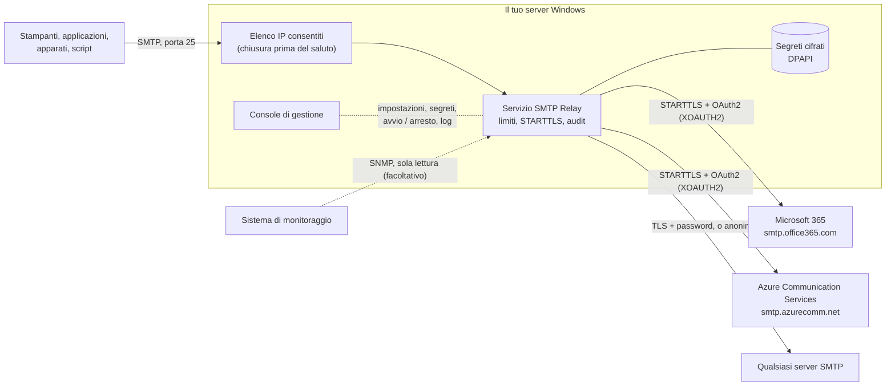

- Il **servizio** (`SmtpRelay.exe`) accetta un messaggio solo da un indirizzo consentito, lo inoltra subito e
  risponde al client con l'esito. Non tiene una coda: quando lo smart host non è raggiungibile il client riceve `451`
  e riprova, e una copia del messaggio viene salvata come `.eml`.
- La **console** (`SmtpRelayManager.exe`) modifica `appsettings.json`, salva i segreti, controlla il servizio e
  legge i log. Viene sempre eseguita come amministratore.
- Le **impostazioni** sono in `C:\Program Files\SMTP Relay\appsettings.json`. I **dati** (log, segreti, messaggi
  non consegnati) sono in `C:\ProgramData\SmtpRelay`. Aggiornamenti e riparazioni non toccano né le une né gli altri.

## Log

Tutto si trova in `C:\ProgramData\SmtpRelay\logs` (la cartella si può cambiare) e nella pagina **Logs** della console.

| File | Contenuto |
|---|---|
| `audit-AAAAMMGG.log` | Una riga per messaggio: `DELIVERED` o `FAILED`, indirizzo del client, utente del relay (`-` quando il client non si è autenticato), mittente, destinatari, dimensione, oggetto, durata o motivo |
| `smtp-relay-AAAAMMGG.log` | Log applicativo: avvio e arresto, connessioni rifiutate, nuovi tentativi, errori con i dettagli |
| `manager-AAAAMM.log` | Cosa hanno fatto gli amministratori nella console: impostazioni salvate, segreti modificati, servizio avviato o arrestato, aggiornamenti |
| Registro eventi di Windows | Avvisi ed errori, registro *Applicazione*, origine `SmtpRelay` |
| `..\failed\*.eml` | Una copia di ogni messaggio non consegnato, per la diagnosi o per reinviarlo a mano |

```
2026-11-11 10:38:40.106 +01:00 DELIVERED client=10.20.4.12 user=erp@contoso.com from=erp@contoso.com to=orders@fabrikam.com size=24110 subject=Order confirmation 55012 durationMs=655
2026-11-11 10:42:07.118 +01:00 FAILED client=192.168.10.44 user=- from=scanner@contoso.com to=m.rossi@fabrikam.com size=4821330 subject=Scan 0042 permanent=True reason=5.7.60 Client does not have permissions to send as this sender
```

Un nuovo file inizia ogni giorno e quando si raggiunge il limite di dimensione; i file più vecchi del periodo di
conservazione vengono eliminati automaticamente (31 giorni per impostazione predefinita). Gli oggetti dei messaggi
fanno parte della riga di audit: se nella tua organizzazione non è accettabile, limita ulteriormente l'accesso alla
cartella o disattiva l'audit.

## Messaggi non consegnati

Il relay non ha una coda propria. Quando lo smart host non può prendere un messaggio, l'apparato che lo ha inviato
riceve un errore temporaneo (`451`) e ci si aspetta che lo reinvii da solo, come con qualsiasi server SMTP. Quando
lo smart host rifiuta un messaggio, l'apparato riceve `554`. In entrambi i casi il relay ne conserva una copia, e la
pagina **Undelivered** della console le elenca:

<p align="center">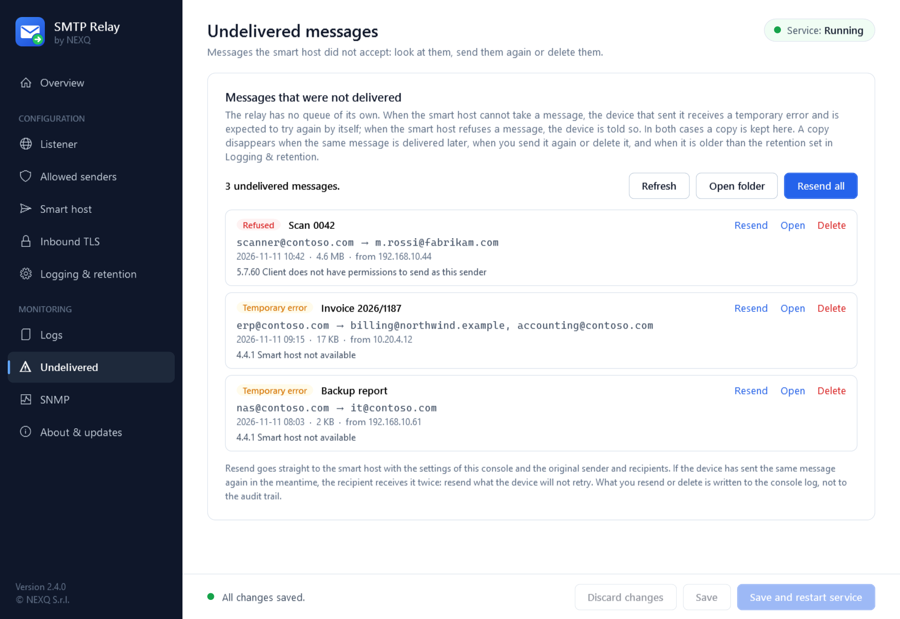</p>

- Di ogni messaggio vedi oggetto, mittente e destinatari della busta SMTP (compresi quelli nascosti), l'apparato
  da cui è arrivato, quando, e cosa ha risposto lo smart host. *Temporary error* significa che lo smart host non
  era disponibile; *Refused* significa che ha risposto di no (mittente sbagliato, destinatario non accettato,
  messaggio troppo grande).
- **Resend** invia la copia direttamente allo smart host con mittente e destinatari originali, usando le
  impostazioni della console, e la toglie dall'elenco quando lo smart host la accetta. **Resend all** lo fa per
  tutto l'elenco. **Open** mostra il messaggio nel programma di posta. **Delete** elimina la copia senza inviarla.
- Una copia sparisce da sola quando l'apparato consegna lo stesso messaggio più tardi (lo si riconosce dal
  Message-ID), e quando è più vecchia del periodo di conservazione (30 giorni per impostazione predefinita,
  **Logging & retention**).

Prima di reinviare, chiediti se l'apparato riproverà: se lo ha già fatto, il destinatario riceve il messaggio due
volte. Reinviare un messaggio *Refused* funziona solo dopo aver rimosso la causa. Ciò che reinvii o elimini viene
scritto nel log della console (`manager-*.log`); non viene aggiunto all'audit né ai contatori del giorno. Le copie
salvate dalle versioni precedenti alla 2.3.0 non hanno la busta: i destinatari sono letti dalle intestazioni.

## Chi usa il relay

La tabella di **Allowed senders** mostra, per ogni indirizzo o rete:

| Colonna | Cosa mostra |
|---|---|
| **DNS name** | Il nome di un indirizzo singolo, dal suo record PTR nel tuo DNS. Vuoto quando non c'è, e per le reti |
| **Last used** | L'ultima volta che ha inviato un messaggio |
| **Messages** | Quanti messaggi sono stati inoltrati allo smart host, con accanto quelli falliti. Una rete somma i suoi indirizzi |

Una voce con *Never* non ha inviato nulla nel periodo: è una buona candidata alla rimozione. Le due icone in fondo
alla riga agiscono sulla voce, ed entrambe chiedono conferma:

- **Disable** (pausa) tiene la voce nell'elenco ma ne rifiuta le connessioni; **Enable** (play) le accetta di
  nuovo. Serve per spegnere un apparato per un po', o per verificare che a nessuno manchi una voce prima di
  rimuoverla.
- **Remove** (cestino) elimina la voce.

Come ogni modifica all'elenco, hanno effetto dopo **Save and restart service**.

I valori sono letti dall'audit delle consegne, quindi coprono i giorni di conservazione dei log (31 per
impostazione predefinita) e sono vuoti quando l'audit è disattivato. Per contare su un periodo più lungo, aumenta i
giorni in **Logging & retention**. La console chiede i nomi al tuo server DNS quando si apre la pagina; il servizio
non lo fa mai.

## Il grafico della pagina Overview

Sotto lo stato del servizio, la pagina **Overview** disegna i messaggi consegnati e falliti nel tempo: le ultime
24 ore ora per ora, oppure gli ultimi 7 o 30 giorni dal selettore a destra. È disegnato dall'audit, quindi i 30
giorni sono completi solo se i log vengono conservati così a lungo.

## Più amministratori

Solo una console alla volta può modificare le impostazioni. Quando un amministratore apre la console mentre un
altro l'ha aperta sullo stesso server (ad esempio in un'altra sessione di Desktop remoto), la seconda console si
apre in **sola lettura**: si possono guardare tutte le pagine, i log e i messaggi non consegnati, non si può
modificare nulla, e un'etichetta *Read-only* in alto dice chi sta modificando.

- Fai clic sull'etichetta per chiedere all'altro amministratore di chiudere. Vede un messaggio con il tuo nome e
  sceglie se chiudere; se preferisce tenere aperta la console, ti viene comunicato.
- Quando la sua console si chiude, la tua chiede se passare alla modifica. Rilegge allora le impostazioni, così
  parti da ciò che è stato salvato.
- Una console in sola lettura mostra ciò che l'altro salva, dopo pochi secondi.

## Backup e spostamento su un altro server

**About & updates > Backup and restore** salva la configurazione in un solo file (`.srbackup`):

| Nel backup | Non nel backup |
|---|---|
| Le impostazioni (`appsettings.json`) | I certificati (TLS in ingresso, registrazione dell'app) |
| I segreti salvati: password dello smart host, client secret, password del `.pfx`, community SNMP | I log e l'audit |
| Gli utenti del relay (gli hash delle password) | I messaggi non consegnati |

I segreti salvati sono legati al computer e altrove non sarebbero leggibili, quindi il backup li contiene in chiaro
dentro un file cifrato con una password scelta da te (AES-256). Senza la password il file non si può ripristinare,
e la password non si può recuperare: conserva entrambi al sicuro.

Per spostare il relay:

1. Sul vecchio server: **Back up settings…**, scegli una password, salva il file.
2. Sul nuovo server: installa SMTP Relay, apri **About & updates**, **Restore from a backup…**.
3. Se usi certificati, esportali dal vecchio server con la chiave privata e importali in
   *Computer locale > Personale* sul nuovo. La console ti avvisa quando le impostazioni ne hanno bisogno.
4. Controlla **Listener** (l'indirizzo di ascolto può essere diverso) e premi **Save and restart service**.

Il ripristino sostituisce tutte le impostazioni, i segreti e gli utenti dell'installazione. Lo stesso si può fare
da riga di comando con `SmtpRelay.exe backup --file <percorso>` e `SmtpRelay.exe restore --file <percorso>`.

## Monitoraggio con SNMP

Il relay ha un piccolo agente SNMP proprio (SNMP v1 e v2c, sola lettura). È **separato dal servizio SNMP di
Windows**: quel servizio mantiene la porta UDP 161 e non viene modificato né richiesto; il relay risponde su una
porta propria, la **1161** per impostazione predefinita. L'agente è spento finché non lo attivi.

| Valore | OID | Tipo |
|---|---|---|
| Consegnati oggi (`smtpRelayDeliveredToday`) | `1.3.6.1.4.1.99999.1.1.1.1.0` | Gauge32 |
| Falliti oggi (`smtpRelayFailedToday`) | `1.3.6.1.4.1.99999.1.1.1.2.0` | Gauge32 |

Sono gli stessi numeri della pagina Overview: contano i messaggi (non i destinatari), tornano a zero a mezzanotte,
ora locale, e sopravvivono al riavvio del servizio. Un messaggio fallito che il client invia di nuovo è contato a
ogni tentativo. L'agente risponde anche a `sysDescr`, `sysObjectID`, `sysUpTime` e `sysName`, così può essere
aggiunto come dispositivo.

Per attivarlo apri la pagina **SNMP** della console:

1. Attiva **Answer SNMP requests**.
2. Scrivi una **community** e premi **Store**. È conservata nell'archivio cifrato, non nel file delle impostazioni.
3. Aggiungi il sistema di monitoraggio in **Monitoring systems allowed to ask**: il suo indirizzo IP, una rete in
   notazione CIDR, oppure il suo nome DNS (`nms01.contoso.local`). Le richieste da qualsiasi altro indirizzo, o con
   un'altra community, non ricevono risposta. Un nome DNS viene tradotto nei suoi indirizzi all'avvio del servizio e
   ogni cinque minuti; se il nome smette di risolversi, restano validi gli ultimi indirizzi.
4. Premi **Save and restart service**.

Poi, dal sistema di monitoraggio:

```
snmpget -v2c -c <community> server-relay:1161 1.3.6.1.4.1.99999.1.1.1.1.0 1.3.6.1.4.1.99999.1.1.1.2.0
```

Il file MIB **`NEXQ-SMTP-RELAY-MIB.txt`** è allegato a ogni release, è installato nella cartella `mib` del
programma e si può salvare dalla pagina SNMP. Importalo nel sistema di monitoraggio per vedere i nomi.

La regola firewall del setup consente già al programma del relay di ricevere UDP. Se non l'hai scelta, consenti
la porta UDP 1161 in ingresso dal sistema di monitoraggio.

> **Nota sull'OID.** `99999` è un segnaposto: NEXQ S.r.l. non ha ancora un private enterprise number assegnato da
> IANA. I numeri cambieranno nella release successiva all'assegnazione (i nomi nella MIB no), quindi nel sistema di
> monitoraggio preferisci i nomi della MIB.

> SNMP v1 e v2c trasmettono community e valori in chiaro. Tieni l'agente su una rete di gestione e limitalo
> all'indirizzo del sistema di monitoraggio come descritto sopra.

## Riferimento della configurazione

La console scrive `appsettings.json` per te. Ogni impostazione si può anche definire con una variabile di ambiente
`SMTPRELAY_SmtpRelay__<Sezione>__<Nome>`. Le modifiche vengono lette all'avvio del servizio.

| Impostazione | Predefinito | Significato |
|---|---|---|
| `Listener.IpAddress` / `Port` | `0.0.0.0` / `25` | Dove ascolta il relay |
| `Listener.ServerName` | `smtp-relay` | Nome nel saluto SMTP |
| `Listener.MaxMessageSizeBytes` | `26214400` | Messaggio più grande accettato (25 MB) |
| `Listener.MaxRecipients` | `100` | Destinatari per messaggio |
| `Listener.MaxConcurrentSessions` | `50` | Sessioni servite contemporaneamente |
| `Security.AllowedIps` | `127.0.0.1`, `::1` | Indirizzi e reti CIDR che possono inviare |
| `Security.DisabledIps` | vuoto | Voci dell'elenco disattivate: conservate, ma non possono inviare |
| `Security.RejectWhenAllowListEmpty` | `true` | Con l'elenco vuoto rifiuta tutti |
| `Security.Authentication.Mode` | `Disabled` | Accesso dei client: `Disabled`, `Optional`, `Required` |
| `Security.Authentication.AllowFromAnyAddress` | `false` | Gli utenti che si autenticano possono connettersi da fuori elenco |
| `Security.Authentication.AllowWithoutTls` | `false` | Accetta le password su sessioni non cifrate |
| `Tls.Mode` | `None` | `None`, `StartTlsOptional`, `StartTlsRequired` |
| `Tls.CertificateThumbprint` / `CertificatePath` | vuoto | Certificato per STARTTLS |
| `Upstream.Mode` | `Microsoft365` | `Microsoft365`, `AzureCommunicationServices`, `Basic`, `Anonymous` |
| `Upstream.Host` / `Port` / `Security` | `smtp.office365.com` / `587` / `StartTls` | Lo smart host. Sicurezza: `StartTls`, `SslOnConnect`, `Auto`, `StartTlsWhenAvailable`, `None` |
| `Upstream.AllowInsecureAuthentication` | `false` | Consente le credenziali su una connessione che potrebbe essere in chiaro |
| `Upstream.MaxAttempts` / `RetryBaseDelaySeconds` | `3` / `5` | Nuovi tentativi sugli errori temporanei |
| `Upstream.OverrideFromAddress` | vuoto | Mittente di busta fisso |
| `Upstream.Microsoft365.*` | | `TenantId`, `ClientId`, `SenderUsername`, `Credential` (`ClientSecret` o `Certificate`), `ClientSecretName`, `CertificateThumbprint` |
| `Upstream.AzureCommunication.*` | | `TenantId`, `ClientId`, `SmtpUsername`, `Credential` (`ClientSecret` o `Certificate`), `ClientSecretName`, `CertificateThumbprint` |
| `Upstream.Basic.*` | | `Username`, `PasswordSecret` |
| `Logging.MinimumLevel` | `Information` | Da `Verbose` a `Fatal` |
| `Logging.RetainedFileTimeLimitDays` / `RetainedFileCountLimit` | `31` / `31` | Conservazione |
| `Logging.AuditTrail` / `EventLog` | `true` / `true` | File di audit e registro eventi di Windows |
| `Delivery.SpoolFailedMessages` / `FailedSpoolRetentionDays` | `true` / `30` | Copie dei messaggi non consegnati |
| `Updates.CheckOnStartup` | `true` | La console cerca una versione più recente all'apertura |
| `Snmp.Enabled` | `false` | Attiva l'agente SNMP |
| `Snmp.IpAddress` / `Port` | `0.0.0.0` / `1161` | Dove ascolta l'agente SNMP (UDP): un indirizzo IP, o un nome DNS di questo computer |
| `Snmp.AllowedManagers` | vuoto | Indirizzi, reti CIDR e nomi DNS dei sistemi di monitoraggio; vuoto non risponde a nessuno |
| `Snmp.CommunitySecret` | `SnmpCommunity` | Nome del segreto salvato che contiene la community |

I segreti (`M365ClientSecret`, `AcsClientSecret`, `UpstreamPassword`, `TlsCertPassword`, `SnmpCommunity`) non sono mai in questo file: le impostazioni
contengono solo il *nome* del segreto, il valore è nello store cifrato. Gli utenti del relay sono in `users.json`
nella cartella dati, come hash con salt.

### Riga di comando

`SmtpRelay.exe` nella cartella di installazione (prompt come amministratore):

| Comando | Cosa fa |
|---|---|
| `install [--account <utente> --password-stdin]` | Registra o ripara il servizio (LocalSystem per impostazione predefinita), protegge la cartella dati |
| `uninstall` | Rimuove il servizio |
| `start` · `stop` · `restart` · `status` | Controlla il servizio (`status` restituisce 0 quando è in esecuzione) |
| `set-credential --name <nome> [--stdin]` | Salva un segreto, cifrato |
| `remove-credential --name <nome>` · `list-credentials` | Rimuove un segreto · elenca i nomi (mai i valori) |
| `set-user --name <utente> [--stdin]` | Crea un utente del relay o ne cambia la password |
| `disable-user` · `enable-user` · `remove-user --name <utente>` · `list-users` | Impedisce l'accesso a un utente · lo riabilita · lo rimuove · elenca gli utenti |
| `backup --file <percorso> [--stdin]` · `restore --file <percorso> [--stdin]` | Salva impostazioni, segreti e utenti in un file cifrato con password · li sostituisce con quelli di un backup |
| `test-upstream` | Si connette e accede allo smart host |
| `show-config` | Mostra la configurazione effettiva, gli avvisi e gli errori |

## Il servizio non parte

| Cosa vedi | Perché | Cosa fare |
|---|---|---|
| Il servizio parte e si ferma subito (*Il servizio su Computer locale è stato avviato e poi arrestato*) | Le impostazioni sono incomplete o non valide, tipicamente subito dopo l'installazione | Apri la console: la pagina Overview elenca cosa manca. Oppure esegui `SmtpRelay.exe show-config` |
| *Errore 1053: il servizio non ha risposto alla richiesta di avvio o controllo in modo tempestivo* | La versione 2.0.0 terminava così ogni volta che le impostazioni non erano valide. Dalla 2.1.0 il servizio risponde prima a Windows e poi si ferma | Aggiorna alla 2.1.0 o successiva e completa le impostazioni come sopra. Se succede ancora, guarda il registro eventi Applicazione (origini `SmtpRelay` e `.NET Runtime`) |
| *Accesso negato* (errore 5), evento 1121 di Microsoft Defender | Un prodotto di sicurezza blocca il programma | Vedi [Antivirus, SmartScreen e firma](#antivirus-smartscreen-e-firma) |
| Gira un istante, il log dice che la porta è in uso | Un altro programma ascolta sulla porta, di solito il servizio SMTP di IIS | Ferma quel programma, oppure cambia la porta nella pagina Listener |

Il motivo è sempre scritto in `C:\ProgramData\SmtpRelay\logs\smtp-relay-YYYYMMDD.log` e nel registro eventi
Applicazione di Windows, origine `SmtpRelay`.

## Aggiornamento e rimozione

**Aggiornamento.** Quando su GitHub c'è una versione più recente la console mostra *Update available*. *About &
updates > Download and install* scarica il setup, confronta il suo SHA-256 con quello pubblicato da GitHub, controlla
che sia firmato da NEXQ S.r.l., poi lo installa: il relay si ferma per circa un minuto e riparte. Impostazioni,
segreti e log restano. Puoi anche eseguire a mano un setup più recente; il risultato è lo stesso.

**Provenendo dalla 2.0.0.** Quella versione era installata in `C:\Program Files\NEXQ\SMTP Relay`. Il setup della
2.1.0 sposta il programma in `C:\Program Files\SMTP Relay`, porta con sé `appsettings.json`, fa puntare il servizio
alla nuova cartella e rimuove la vecchia. I dati in `C:\ProgramData\SmtpRelay` non si spostano.

**Rimozione.** *Impostazioni > App* (o *Programmi e funzionalità*) > *NEXQ SMTP Relay* > *Disinstalla*. Il servizio
e la regola del firewall vengono rimossi. Il setup chiede se eliminare anche impostazioni, segreti e log; per
impostazione predefinita vengono conservati.

## Stato del progetto

La versione 2.4.0 aggiunge il grafico della pagina Overview, il nome DNS e la disattivazione nell'elenco, e la
console in sola lettura per un secondo amministratore. I dati su cui si basano sono coperti da test automatici;
**due console aperte da due amministratori in due sessioni dello stesso server non sono state provate su un server
reale** (i test eseguono il blocco fra due thread). La conservazione dei log si imposta ora solo in
**Logging & retention**.

La versione 2.3.0 aggiunge la pagina Undelivered con il reinvio, le colonne di utilizzo dell'elenco e il backup
delle impostazioni. Le tre funzioni sono coperte da test automatici sui file e sul listener reale; **i pulsanti
della console (Resend, Back up, Restore) non sono stati provati a mano su un server**, e il ripristino su un secondo
computer è stato provato solo fra due cartelle dello stesso computer. Prova il ripristino prima di dismettere il
vecchio server.

La versione 2.2.0 aggiunge l'accesso dei client con gli utenti propri del relay e l'importazione dell'elenco da
IIS 6. L'accesso è coperto dai test automatici sul listener reale. **L'importazione da IIS 6 è stata provata solo
con dati costruiti per i test**, non su un server con il servizio SMTP di IIS: controlla le voci che propone prima
di salvare. La riga di audit ha un campo nuovo, `user=`, dopo `client=`: adegua ciò che la interpreta.
La versione 2.2.1 corregge l'importazione, che nella 2.2.0 rifiutava l'elenco di un vero server IIS. Se l'elenco
non viene ancora interpretato, la console scrive nel proprio log (`manager-*.log`) il valore trovato: allega quella
riga alla segnalazione. Inoltre l'agente SNMP accetta nomi DNS, per i sistemi di monitoraggio e per l'indirizzo
su cui ascolta. La versione 2.2.2 corregge i contatori del giorno: dalla 2.1.0 la pagina Overview mostrava sempre
zero messaggi consegnati e falliti, e i valori SNMP tornavano a zero al riavvio del servizio.

La versione 2.1.0 aggiunge Azure Communication Services, le credenziali con certificato e l'agente SNMP. L'agente
SNMP è provato con un client SNMP indipendente, e le due modalità OAuth2 con un server di prova. **L'accesso ai veri
Microsoft 365 e Azure Communication Services con certificato non è coperto dai test automatici** (serve un tenant):
usa **Test connection** prima di farci affidamento. Lo spostamento di una installazione 2.0.0 nella nuova cartella è
fatto dal setup e ha lo stesso stato del resto del setup, descritto sotto.

La versione 2.0.0 è la prima con il setup, la console e il meccanismo di aggiornamento. Il relay vero e proprio
(elenco IP, limiti, inoltro, nuovi tentativi, audit, segreti) e la verifica degli aggiornamenti sono coperti da una
suite di test automatici che esegue il listener reale contro uno smart host di prova. Il setup, la registrazione del
servizio, la regola del firewall e l'aggiornamento dalla console sono stati compilati e verificati come pacchetti
firmati, ma **non sono ancora stati validati dall'inizio alla fine su ogni versione di Windows supportata**:
installa prima su un server di prova e tieni il relay precedente finché non hai visto i tuoi apparati consegnare
attraverso questo. SMTP Relay non ha avuto una revisione di sicurezza indipendente.

Non esporre la porta di ascolto a Internet. Il relay è pensato per una rete interna, dietro il tuo firewall.

## Compilazione dai sorgenti

Prerequisiti: Windows, .NET SDK 10 e [Inno Setup 6](https://jrsoftware.org/isinfo.php) per il setup.

```powershell
dotnet build SMTPRelay.slnx
dotnet test SMTPRelay.slnx
dotnet run --project src/SmtpRelay.Service                 # il relay nella console, sulla porta 2525
dotnet run --project src/SmtpRelay.Manager                 # la console di gestione (Debug: senza elevazione)

# release: file self-contained, firme, setup, zip e checksum in artifacts\release
dotnet msbuild build\Release.proj -restore -t:Release -p:SignThumbprint=<thumbprint del tuo certificato di firma del codice>
```

| Cartella | Contenuto |
|---|---|
| `src/SmtpRelay.Core` | Configurazione, validazione, segreti, elenco IP, consegna allo smart host |
| `src/SmtpRelay.Service` | Il servizio Windows e la riga di comando |
| `src/SmtpRelay.Manager` | La console di gestione (WPF) |
| `tests/SmtpRelay.Tests` | Test unitari ed end-to-end |
| `installer` · `build` | Script di Inno Setup · build della release |

## Sicurezza

Elenco IP fail-closed, cifratura imposta verso lo smart host, segreti cifrati e legati al computer, cartella dati
chiusa agli utenti ordinari, file firmati, aggiornamenti verificati, nessuna telemetria. I dettagli e i limiti sono
in [SECURITY_IT.md](SECURITY_IT.md). **Per segnalare una vulnerabilità non aprire una issue pubblica**: segui
[SECURITY_IT.md](SECURITY_IT.md).

## Contribuire

Leggi prima [CONTRIBUTING.md](CONTRIBUTING.md). In breve: non indebolire mai un'impostazione fail-closed, non
scrivere mai un segreto o il corpo di un messaggio in un log, tieni ogni testo dell'interfaccia in inglese chiaro e
aggiungi un test per ciò che modifichi.

## Licenza

SMTP Relay è sviluppato da [NEXQ](https://www.nexq.it/?utm_source=github&utm_medium=referral&utm_campaign=smtprelay) e
rilasciato con la **[PolyForm Shield License 1.0.0](https://polyformproject.org/licenses/shield/1.0.0)**
([LICENSE](LICENSE)), una licenza standard di tipo source-available:

- **Gratuito per uso personale e aziendale**, anche in produzione, senza limiti di server, apparati, caselle o
  messaggi.
- **Il codice sorgente è pubblico**: puoi studiarlo, modificarlo, basarti su di esso e distribuirne copie con la
  licenza e la riga `Required Notice`.
- **Non è consentito rivendere SMTP Relay**: la licenza vieta di fornire qualsiasi prodotto in concorrenza con esso,
  quindi non è consentito venderlo, vendere versioni modificate o rinominate, né offrirlo come prodotto o servizio
  concorrente.
- **Diritti commerciali aggiuntivi**: contatta NEXQ tramite [www.nexq.it](https://www.nexq.it/?utm_source=github&utm_medium=referral&utm_campaign=smtprelay).

Non è una licenza open source approvata da OSI (GitHub la mostra come "Other"). I componenti di terze parti
mantengono le proprie licenze: vedi [NOTICE](NOTICE).

Copyright (c) NEXQ S.r.l. · [www.nexq.it](https://www.nexq.it/?utm_source=github&utm_medium=referral&utm_campaign=smtprelay)

"Microsoft 365", "Exchange", "Windows Server" e "Microsoft Entra" sono marchi del gruppo di società Microsoft.
SMTP Relay è un progetto indipendente e non è affiliato a Microsoft né da essa approvato.
